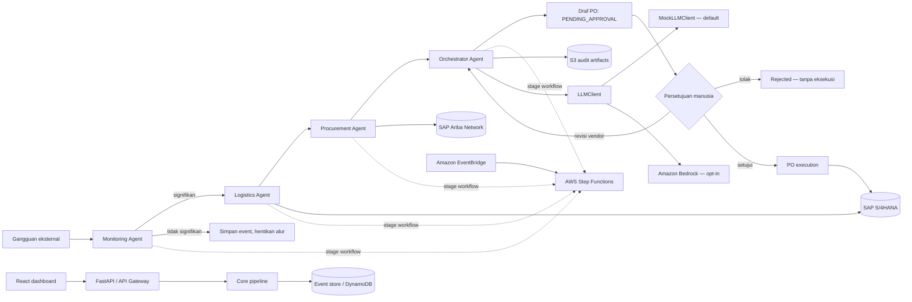

# ChainMind — Autonomous Disruption Resolver

> **English summary:** ChainMind is an offline-first, human-approved agentic AI demo for manufacturing supply-chain disruptions. It evaluates inventory risk and alternate suppliers, then prepares—but never automatically executes—a purchase order.

[](https://www.python.org/)
[](https://fastapi.tiangolo.com/)
[](https://react.dev/)
[](https://aws.amazon.com/cdk/)
[](./LICENSE)
[](https://github.com/Erlangga31/ChainMind/actions/workflows/ci.yml)

## Ikhtisar

Rantai pasok manufaktur memerlukan lebih dari sekadar alarm ketika pengiriman terlambat: tim operasi perlu memahami dampak stok, mengevaluasi alternatif vendor, dan menyiapkan tindakan yang bisa ditinjau dengan cepat. ChainMind adalah fondasi demo agentic AI untuk alur tersebut.

Sistem ERP tradisional berperan sebagai **system of record**: SAP menyimpan stok, data pemasok, dan transaksi. ChainMind menambahkan lapisan **system of action**: sejumlah agent mengubah sinyal gangguan menjadi analisis dampak, perbandingan vendor, dan draf PO yang dapat ditinjau manusia. Persetujuan manusia tetap menjadi batas wajib sebelum eksekusi.

## Skenario demo

- Kapal pengangkut Microchip X terlambat **5 hari** karena cuaca ekstrem.
- Stok SAP S/4HANA hanya mencukupi **3 hari** produksi.
- Monitoring mengklasifikasikan gangguan sebagai **High**; Logistics menghitung potensi stockout 2 hari dan perkiraan kerugian akibat berhenti produksi.
- Procurement membandingkan **empat vendor** Ariba, kapasitas, waktu kirim, biaya, serta estimasi dampak risiko.
- Orchestrator memilih **Vendor B**: pengiriman 2 hari, risiko residual terendah, dan biaya aksi tersesuaikan risiko **$135.000**.
- Mock S/4HANA mencatat draf **5.000 pcs × $27 = $135.000**, Air Freight, status **`PENDING_APPROVAL`**. Sistem menunggu approve, reject, atau revisi dari manusia.

## Arsitektur



| Tahap | Demo lokal | Target AWS/SAP |
| --- | --- | --- |
| Ingest dan run history | FastAPI, event store in-memory | API Gateway, EventBridge, DynamoDB |
| Monitoring | JSON inventory seed, Monitoring Agent, SAP sandbox Event Mesh | Lambda, SAP S/4HANA melalui SAP Integration Suite |
| Analisis logistik | Logistics Agent dan seed ekonomi produksi | Lambda dan data SAP |
| Perbandingan pengadaan | JSON seed vendor, Procurement Agent | Lambda dan SAP Ariba Network melalui SAP Integration Suite |
| Pemilihan dan rationale | Orchestrator Agent, MockLLMClient | Lambda, Bedrock Converse, artefak audit privat di S3 |
| Approval dan eksekusi | API/dashboard dan mock SAP | Step Functions callback, otorisasi manusia, SAP S/4HANA |

Sandbox SAP lokal pada `sandbox/sap_sandbox/` menyediakan endpoint OData, vendor Ariba, webhook Event Mesh, dan workflow approval simulasi. Sandbox ini membantu pengujian kontrak HTTP lokal; bukan koneksi atau tenant SAP produksi.

Stack CDK mendefinisikan service AWS dan callback wait. Pengaitan endpoint keputusan lokal/API dengan token callback Step Functions dan koneksi SAP nyata masih termasuk pekerjaan sebelum deployment produksi.

## Tech stack

| Area | Teknologi |
| --- | --- |
| Backend dan API | Python 3.12, FastAPI, Pydantic v2, pydantic-settings |
| Integrasi AWS | boto3, Amazon Bedrock Converse, DynamoDB |
| Agent AI | `LLMClient`, `MockLLMClient` offline, `BedrockLLMClient` opsional |
| Integrasi SAP | Kontrak `SAPClient`/`AribaClient`, mock S/4HANA dan Ariba, stub SAP Integration Suite |
| Workflow dan IaC | AWS Lambda, EventBridge, Step Functions, API Gateway, S3, AWS CDK for Python |
| Dashboard | React, TypeScript, Vite, Tailwind CSS |
| Validasi kualitas | pytest, Ruff, GitHub Actions |

## Quick start

### Backend dan API (Python 3.12)

```powershell
uv sync --extra dev
uv run python scripts/run_demo.py
uv run uvicorn chainmind.api.main:app --app-dir src --reload
```

API tersedia di `http://localhost:8000`; OpenAPI UI di `http://localhost:8000/docs`.

### Dashboard

Di terminal kedua:

```powershell
cd dashboard
npm ci
npm run dev
```

Buka alamat Vite (umumnya `http://localhost:5173`), lalu pilih **Trigger demo disruption**. Dashboard menampilkan run, linimasa enam tahap, perbandingan vendor, ringkasan rationale, draf PO, dan kontrol approve/reject/revise.

### Tes, lint, dan sintesis infrastruktur

Dari root proyek:

```powershell
uv run pytest -q
uv run ruff check src tests scripts infra sandbox
uv run ruff format --check src tests scripts infra sandbox
uv pip install --python .venv\Scripts\python.exe -r infra\requirements.txt
cd infra
npx --yes aws-cdk synth
```

CDK dapat disintesis tanpa Docker atau kredensial AWS. Untuk menyiapkan virtual environment dengan `pip` bila `uv` belum tersedia, lihat petunjuk di [docs/DEMO.md](./docs/DEMO.md).

## Mock mode dan AWS mode

Mode default `CHAINMIND_MODE=mock` berjalan lokal dan deterministik, tanpa AWS credentials atau koneksi SAP. Preset `CHAINMIND_MODE=aws` memilih backend LLM Bedrock dan SAP Integration Suite; pilihan dapat ditimpa secara terpisah memakai `CHAINMIND_SAP_BACKEND` dan `CHAINMIND_LLM_BACKEND`. Sandbox lokal memakai HTTP dan seed fixture. Koneksi Integration Suite produksi masih memerlukan tenant dan kontrak API SAP yang tervalidasi.

CDK mendefinisikan empat Bedrock Agents dan alias, lima action schema Lambda, serta guardrail untuk PII dan topik di luar supply chain. `bedrock_agents` memakai runtime agent untuk penjelasan dan trace; pemilihan vendor, coverage, dan perhitungan biaya tetap dilakukan oleh Python. Agent AWS memerlukan model/alias yang tersedia di akun dan region tujuan. Definisi ini baru diuji dengan template CDK, belum dideploy atau divalidasi di akun AWS.

Salin `.env.example` ke `.env` bila ingin mengubah konfigurasi lokal. `.env` tidak boleh ditambahkan ke repository.

| Variabel | Default | Kegunaan |
| --- | --- | --- |
| `CHAINMIND_MODE` | `mock` | Pilihan adapter: `mock` atau `aws` |
| `CHAINMIND_SAP_BACKEND` | preset dari `CHAINMIND_MODE` | Pilihan SAP: `mock`, `sandbox`, `real` |
| `CHAINMIND_LLM_BACKEND` | preset dari `CHAINMIND_MODE` | Pilihan model: `mock`, `bedrock`, `bedrock_agents` |
| `CHAINMIND_AWS_REGION` | `us-east-1` | AWS region untuk boto3 dan Bedrock |
| `CHAINMIND_BEDROCK_MODEL_ID` | `anthropic.claude-3-haiku-20240307-v1:0` | ID model Converse Bedrock |
| `CHAINMIND_BEDROCK_AGENT_ID` | — | ID agent untuk backend `bedrock_agents` |
| `CHAINMIND_BEDROCK_AGENT_ALIAS_ID` | — | Alias agent yang dipakai saat runtime |
| `CHAINMIND_STOCKOUT_TOLERANCE_DAYS` | `0` | Toleransi waktu kedatangan di luar cakupan stok |
| `CHAINMIND_SAFETY_RESERVE_DAYS` | `0.25` | Cadangan hari untuk estimasi stockout residual |
| `CHAINMIND_RETRY_ATTEMPTS` | `3` | Percobaan maksimal integrasi |
| `CHAINMIND_RETRY_BASE_DELAY_SECONDS` | `0.1` | Jeda awal exponential backoff |
| `CHAINMIND_EVENT_TABLE_NAME` | `chainmind-events` | Tabel event/run DynamoDB |
| `CHAINMIND_ARTIFACT_BUCKET_NAME` | `chainmind-artifacts` | Nama bucket artefak yang dapat dikonfigurasi |
| `CHAINMIND_API_CORS_ORIGINS` | `["http://localhost:5173","http://127.0.0.1:5173"]` | Daftar origin JSON yang diizinkan |
| `CHAINMIND_SAP_BASE_URL` | — | Titik konfigurasi untuk integrasi SAP mendatang |
| `CHAINMIND_SAP_INTEGRATION_SUITE_URL` | — | Base URL SAP Integration Suite untuk backend `real` |
| `CHAINMIND_SAP_TOKEN_URL` | — | OAuth2 client-credentials token endpoint |
| `CHAINMIND_SAP_CLIENT_ID` | — | Client ID SAP pada development lokal |
| `CHAINMIND_SAP_CLIENT_SECRET` | — | Client secret SAP pada development lokal; jangan commit |
| `CHAINMIND_SAP_SECRETS_SECRET_ID` | — | Secrets Manager secret ID untuk AWS mode |
| `CHAINMIND_SAP_TIMEOUT_SECONDS` | `10` | Timeout HTTP SAP |
| `CHAINMIND_SAP_WORKFLOW_BASE_URL` | `http://127.0.0.1:8100` | Base URL Business Workflow sandbox |
| `SAP_SANDBOX_EVENT_WEBHOOK_URL` | `http://127.0.0.1:8000/disruptions` | Tujuan webhook Event Mesh simulator lokal |
| `SAP_SANDBOX_WORKFLOW_CALLBACK_URL` | `http://127.0.0.1:8000` | Base URL callback workflow simulator lokal |

AWS credentials tidak dimasukkan ke berkas konfigurasi proyek: boto3 menggunakan AWS credential chain standar.
Gunakan kredensial dummy hanya untuk SAP sandbox lokal. Backend `real` belum diverifikasi terhadap tenant SAP asli.

### SAP sandbox lokal

Jalankan di terminal lain:

```powershell
uv run uvicorn sap_sandbox.main:app --app-dir sandbox --host 127.0.0.1 --port 8100 --reload
```

OpenAPI UI tersedia di `http://localhost:8100/docs`. Simulator mencakup OData stock dan purchase order, Ariba sourcing/offer, OAuth token demo, Event Mesh webhook, workflow approval callback, dan empat skenario gangguan. `make run-sap-sandbox` menjalankan perintah server yang sama pada lingkungan yang menyediakan `make`.

## Struktur proyek

```text
chainmind/
├── .github/                 # CI, Dependabot, issue dan PR templates
├── dashboard/               # React + TypeScript + Vite + Tailwind
├── docs/                    # Arsitektur, API, dan skenario presentasi
├── infra/                    # AWS CDK untuk Python
├── scripts/                  # Demo CLI
├── sandbox/sap_sandbox/      # Simulator lokal OData, Ariba, Event Mesh, workflow
├── src/chainmind/
│   ├── agents/               # Monitoring, logistics, procurement, orchestrator
│   ├── api/                  # FastAPI routes
│   ├── core/                 # Model, config, audit, event store, retry
│   ├── data/                 # Seed scenario, inventory, vendor
│   ├── handlers/             # Wrapper AWS Lambda
│   ├── integrations/         # LLM, SAP, AWS adapters
│   └── workflow/             # Pipeline empat stage framework-agnostic
├── tests/                    # Unit, API, retry, dan end-to-end
├── .env.example
├── pyproject.toml
└── README.md
```

## Roadmap dan batas MVP

- [ ] Hubungkan `RealSAPClient` dan `RealAribaClient` ke SAP Integration Suite, OAuth, dan OData resmi.
- [ ] Paketkan dependency Python untuk Lambda deployment dan verifikasi runtime Python 3.12.
- [ ] Hubungkan endpoint approval ke callback token Step Functions (`SendTaskSuccess`/`SendTaskFailure`) dan tambahkan idempotensi.
- [ ] Terapkan identity provider, otorisasi approver berbasis peran, dan secret management AWS Secrets Manager.
- [ ] Perkuat retensi, audit log, observability, alarm, dan pengujian integrasi dengan SAP sandbox.

**Disclaimer MVP:** integrasi SAP saat ini adalah mock/stub; seed data, event store mock, dan keputusan human-in-the-loop lokal dimaksudkan untuk demo. AWS CDK adalah scaffold yang dapat disintesis, bukan deployment atau sertifikasi kesiapan produksi.

## Kontribusi

Lihat [CONTRIBUTING.md](./CONTRIBUTING.md) untuk langkah instalasi, pemeriksaan, dan cara mengajukan perubahan.

## License

Proyek ini menggunakan MIT License; sebelum publikasi, ganti placeholder `<YOUR NAME>` di [LICENSE](./LICENSE) dengan nama pemegang hak cipta.
