# ChainMind — Autonomous Disruption Resolver

> **English summary:** ChainMind is an offline-first, human-approved agentic AI demo for manufacturing supply-chain disruptions. It evaluates inventory risk and alternate suppliers, then prepares—but never automatically executes—a purchase order.

### Ringkasan 30 detik

ChainMind membantu tim manufaktur merespons gangguan pasokan: empat agen menganalisis event,
stok, dampak produksi dan pemasok alternatif, lalu menyiapkan draf PO untuk ditinjau manusia.
Pada skenario demo, kapal Microchip X terlambat 5 hari, stok hanya cukup 3 hari, dan Vendor B
menjadi rekomendasi. Persetujuan manusia wajib sebelum eksekusi; demo menggunakan SAP sandbox
dan AWS LocalStack/CDK synth, bukan layanan produksi.
Preset cuaca tersebut adalah data demo deterministik. Penggunaan biasa memakai master data dan
event tenant yang dibuat atau diimpor di Data Studio; analisis berjalan atas data tersimpan.

### 30-second summary

ChainMind helps manufacturing teams respond to supply disruptions: four agents analyze the event,
inventory, production impact, and alternate suppliers, then prepare a draft PO for human review.
In the demo, a Microchip X shipment is delayed five days while stock covers three; Vendor B is
recommended. Human approval is required before execution. The demo uses an SAP sandbox and
AWS LocalStack/CDK synthesis, not production services.

**Proposal flow / Alur proposal**

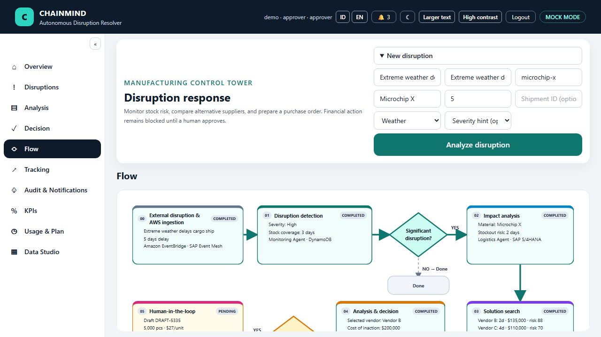

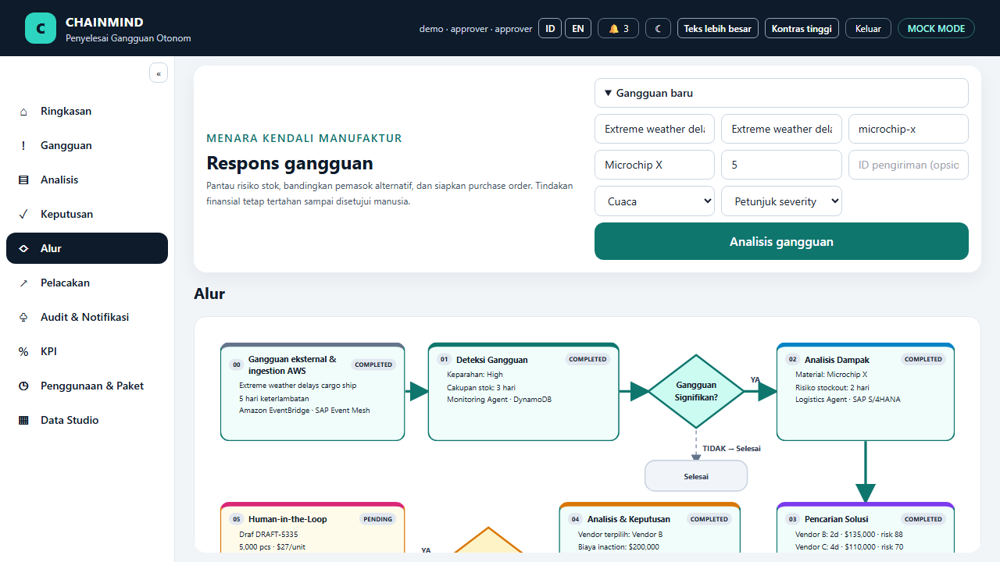

### Dashboard previews

| English · light | English · dark |
| --- | --- |
| 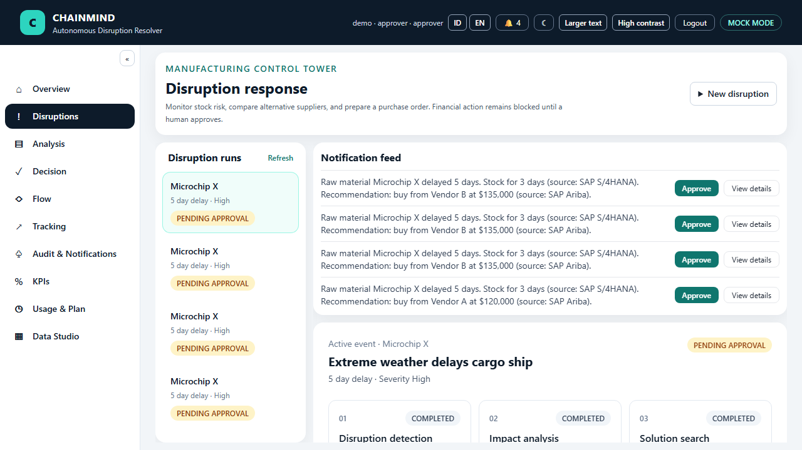 | 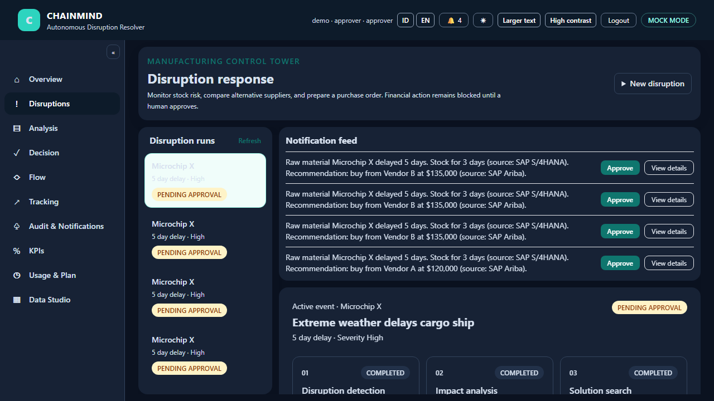 |

| Indonesia · light | Indonesia · dark |
| --- | --- |
|  | 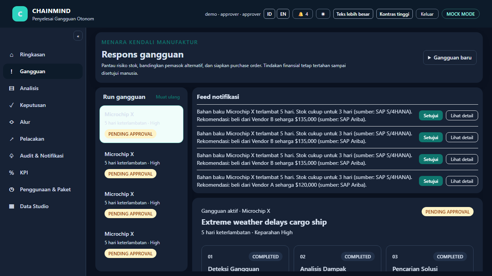 |

[](https://www.python.org/)
[](https://fastapi.tiangolo.com/)
[](https://react.dev/)
[](https://aws.amazon.com/cdk/)
[](./LICENSE)
[](https://github.com/Erlangga31/ChainMind/actions/workflows/ci.yml)

## Ikhtisar

Rantai pasok manufaktur memerlukan lebih dari sekadar alarm ketika pengiriman terlambat: tim operasi perlu memahami dampak stok, mengevaluasi alternatif vendor, dan menyiapkan tindakan yang bisa ditinjau dengan cepat. ChainMind adalah fondasi demo agentic AI untuk alur tersebut.

Sistem ERP tradisional berperan sebagai **system of record**: SAP menyimpan stok, data pemasok, dan transaksi. ChainMind menambahkan lapisan **system of action**: sejumlah agent mengubah sinyal gangguan menjadi analisis dampak, perbandingan vendor, dan draf PO yang dapat ditinjau manusia. Persetujuan manusia tetap menjadi batas wajib sebelum eksekusi.

## Skenario demo

Angka di bawah adalah preset demo presenter, bukan nilai bawaan yang dipaksakan ke semua tenant.
Data Studio menyediakan CRUD, import/export CSV/JSON, template, reset demo, clear, dan generator
sample deterministik.

- Kapal pengangkut Microchip X terlambat **5 hari** karena cuaca ekstrem.
- Stok SAP S/4HANA hanya mencukupi **3 hari** produksi.
- Monitoring mengklasifikasikan gangguan sebagai **High**; Logistics menghitung potensi stockout 2 hari dan perkiraan kerugian akibat berhenti produksi.
- Procurement membandingkan **empat vendor** Ariba, kapasitas, waktu kirim, biaya, serta estimasi dampak risiko.
- Orchestrator memilih **Vendor B**: pengiriman 2 hari, risiko residual terendah, dan biaya aksi tersesuaikan risiko **$135.000**.
- Mock S/4HANA mencatat draf **5.000 pcs × $27 = $135.000**, Air Freight, status **`PENDING_APPROVAL`**. Sistem menunggu approve, reject, atau revisi dari manusia.
- Setelah disetujui, demo mencatat eksekusi S/4HANA, konfirmasi pemasok dan ASN Ariba, ETA 2 hari, proyeksi stok ilustratif 6.000 pcs, serta KPI simulasi.

## Arsitektur

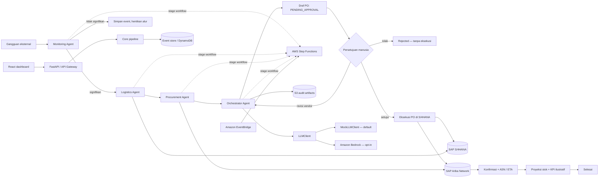

| Tahap | Demo lokal | Target AWS/SAP |
| --- | --- | --- |
| Ingest dan run history | FastAPI, HMAC event bridge, SQLite idempotency store | API Gateway, Secrets Manager, EventBridge, DynamoDB |
| Monitoring | JSON inventory dan shipment records, empat klasifikasi, mock event feeds | Lambda, SAP S/4HANA melalui SAP Integration Suite |
| Analisis logistik | Logistics Agent dan seed ekonomi produksi | Lambda dan data SAP |
| Perbandingan pengadaan | JSON seed vendor, Procurement Agent | Lambda dan SAP Ariba Network melalui SAP Integration Suite |
| Pemilihan dan rationale | Orchestrator Agent, MockLLMClient | Lambda, Bedrock Converse, artefak audit privat di S3 |
| Approval dan eksekusi | API/dashboard dan mock SAP | Step Functions callback, otorisasi manusia, SAP S/4HANA |
| Pelacakan pasca-eksekusi | Konfirmasi Ariba, ASN, proyeksi stok terpisah dari stok aktual | Lambda pelacakan, Ariba, custom API proyeksi S/4HANA |

## Jalur cepat Windows

Dengan Python 3.12, Node.js sesuai versi proyek, dan dependensi yang sudah dipasang:

```powershell
.\scripts\run_all.ps1
```

Buka `http://127.0.0.1:5173`, masuk `approver` / `demo`, picu skenario cuaca, lalu tinjau dan
setujui PO. Panduan: [DEMO](./docs/DEMO.md), [REHEARSAL](./docs/REHEARSAL.md), dan
[Q&A juri](./docs/QNA.md).

Sandbox SAP lokal pada `sandbox/sap_sandbox/` menyediakan endpoint OData V2, metadata EDMX, kontrak JSON Schema di `contracts/sap/`, vendor Ariba, webhook Event Mesh, dan workflow approval simulasi. Uji adapter menggunakan field standar SAP (misalnya `Material`, `Supplier`, `OrderQuantity`, dan `NetPriceAmount`) serta menandai ekstensi `ChainMind*` sebagai custom. Ini adalah contract/sandbox test, bukan koneksi atau tenant SAP produksi. Smoke test tenant opsional didokumentasikan di [DEPLOY.md](./docs/DEPLOY.md); tidak berjalan otomatis dan perlu URL/kredensial SAP yang diberikan pemilik tenant.

Event Mesh simulator mengirim event ke `/event-bridge` dengan HMAC-SHA256. Untuk menjalankan kedua proses lokal, isi `CHAINMIND_EVENT_BRIDGE_SECRET` dan `SAP_SANDBOX_EVENT_BRIDGE_SECRET` dengan shared secret yang sama dan non-empty. `OpenMeteoWeatherClient` adalah integrasi opsional yang disabled by default; sumber gangguan lain memakai skenario mock offline.

Stack CDK mendefinisikan service AWS dan callback wait. API keputusan pada jalur AWS melanjutkan callback Step Functions; Cognito authorizer meneruskan bearer ID token yang diverifikasi backend menggunakan issuer, audience, dan JWKS Cognito.

CDK scaffold kini mencakup KMS, VPC/private subnets dan VPC endpoints, Cognito groups dan authorizer, API throttling/access logs, CloudTrail, alarms, serta dashboard CloudWatch. API memverifikasi bearer JWT terhadap issuer, audience, JWKS, dan expiry. Run snapshots dan audit/trace artifact diarsipkan ke S3 pada AWS mode. Sintesis template bukan bukti bahwa Lambda siap deploy atau bahwa integrasi AWS/SAP sudah berjalan; lihat [docs/DEPLOY.md](./docs/DEPLOY.md) sebelum mempertimbangkan deployment.

## Tech stack

| Area | Teknologi |
| --- | --- |
| Backend dan API | Python 3.12, FastAPI, Pydantic v2, pydantic-settings |
| Integrasi AWS | boto3, Amazon Bedrock Converse, DynamoDB |
| Agent AI | `LLMClient`, `MockLLMClient` offline, `BedrockLLMClient` opsional |
| Integrasi SAP | Kontrak `SAPClient`/`AribaClient`, mock S/4HANA dan Ariba, stub SAP Integration Suite |
| Workflow dan IaC | AWS Lambda, EventBridge, Step Functions, API Gateway, S3, AWS CDK for Python |
| Dashboard | React, TypeScript, Vite, Tailwind CSS, Recharts, Vitest |
| Validasi kualitas | pytest, Ruff, GitHub Actions |

## Quick start

### Backend dan API (Python 3.12)

```powershell
uv sync --extra dev
uv run python scripts/run_demo.py
uv run python scripts/run_demo.py --language en
uv run uvicorn chainmind.api.main:app --app-dir src --reload
```

API tersedia di `http://localhost:8000`; OpenAPI UI di `http://localhost:8000/docs`.
Endpoint utama mencakup `POST /disruptions`, `GET /runs`, `GET /runs/{run_id}`,
`POST /runs/{run_id}/decision`, `GET /kpis`, dan `GET /usage`. JWT harus membawa claim tenant
`tenant_id` (atau `custom:tenant_id`); run, idempotency, KPI, dan metering terisolasi per tenant.
`GET /usage` memerlukan role `approver` atau `admin`; keputusan PO memerlukan `approver` atau `admin`.
Usage menghitung run `EXECUTED` pada bulan UTC berjalan; tier dan jumlah agen dapat ditetapkan per tenant.
Tier dan harga di konfigurasi adalah ilustratif, bukan penawaran komersial atau invoice.
KPI mengagregasi run yang sudah selesai tracking; target manual dan estimasi beban kerja diberi label
ilustratif. Role tidak pernah dipilih melalui header. Bypass lokal hanya tersedia dengan
`CHAINMIND_AUTH_DEV_BYPASS=true` saat `CHAINMIND_MODE=mock`, dan tetap mati secara default.

### Fake OIDC provider

Jalankan SAP sandbox di terminal terpisah agar login lokal tersedia:

```powershell
uv run uvicorn sap_sandbox.main:app --app-dir sandbox --host 127.0.0.1 --port 8100 --reload
```

Sandbox menyediakan discovery OIDC, JWKS RS256, authorization code + PKCE, dan dua akun demo (`viewer` atau `approver`, password `demo`). Dashboard memakai token di memori; logout atau expiry mengakhiri sesi. API di luar mock memakai bearer ID token yang diterbitkan IdP dan memeriksa audience/issuer/signature/expiry.

### Dashboard

Di terminal kedua:

```powershell
cd dashboard
npm ci
npm run dev
```

Buka `http://localhost:5173`, klik **Sign in with ChainMind SSO**, lalu masuk sebagai `viewer` atau `approver` (password `demo`). Masukkan gangguan baru dari halaman Disruptions. Approver/admin dapat membuka **Data Studio** untuk mengelola atau mengimpor material, vendor, shipment, dan event tenant; API memvalidasi record dan melaporkan kesalahan impor per baris. Nilai analisis dan KPI dihitung dari data tersimpan/run terkait, bukan dari nilai contoh yang tertanam di komponen dashboard. Viewer tetap read-only; hanya bearer token terverifikasi dengan role approver yang dapat mengirim keputusan.
Gunakan `http://127.0.0.1:5173/?presenter=1` untuk mode presenter: setelah login, skenario cuaca
otomatis dijalankan dan tombol **Lanjut / Next** menggerakkan narasi. Jika API tidak tersedia,
opsi replay hanya-baca dapat memuat fixture hasil mock pipeline; badge **REPLAY** membedakannya dari
run langsung. `.\scripts\run_all.ps1` menjalankan preflight lokal sebelum menyalakan sandbox, API,
dan Vite. Panduan video dan kesiapan akun nyata ada di [VIDEO_SCRIPT.md](./docs/VIDEO_SCRIPT.md)
dan [GO_LIVE.md](./docs/GO_LIVE.md).
Gunakan kontrol **ID/EN** untuk mengganti bahasa; dashboard, notifikasi, dan `run_demo.py`
mendukung bahasa Indonesia dan Inggris. Tampilan kontras tinggi dan teks besar dapat diaktifkan dari
kontrol aksesibilitas. Tabel vendor menampilkan wilayah/jarak dan dampak BOM menandai komponen
paling kritis; ranking dihitung deterministik oleh Python. Data JSON seed hanya dimuat saat store
tenant masih kosong dan ditandai sebagai demo. Data Studio menyediakan aksi reset ke preset demo
dan hapus seluruh data tenant. Generator dataset menerima seed sehingga keluaran dapat direproduksi.

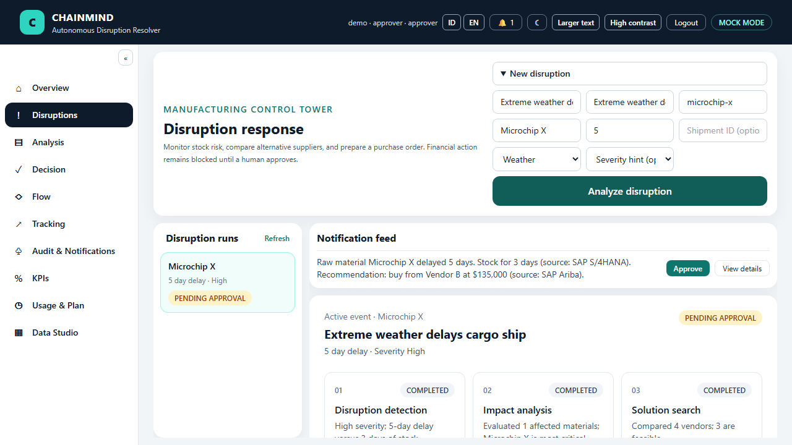

Cuplikan alur demo lain:

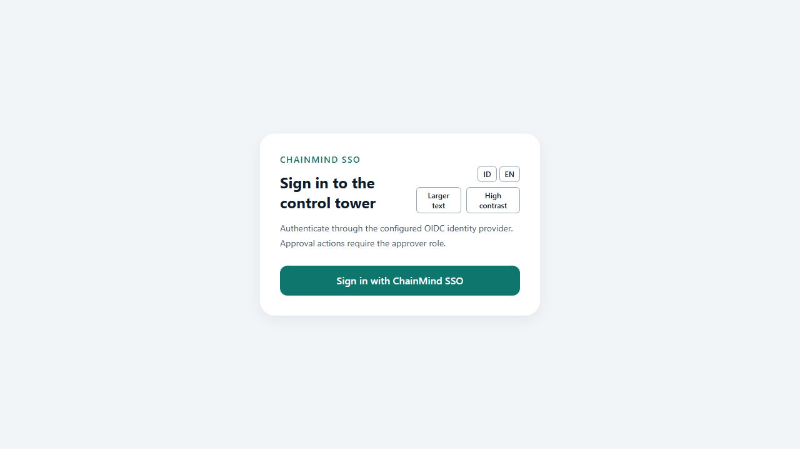
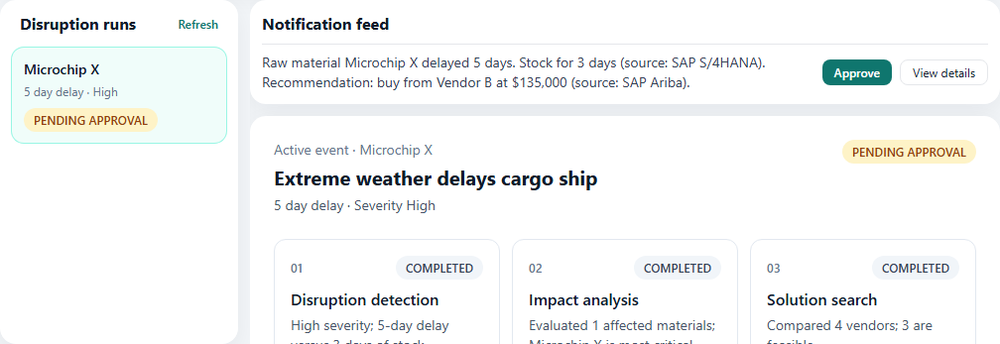
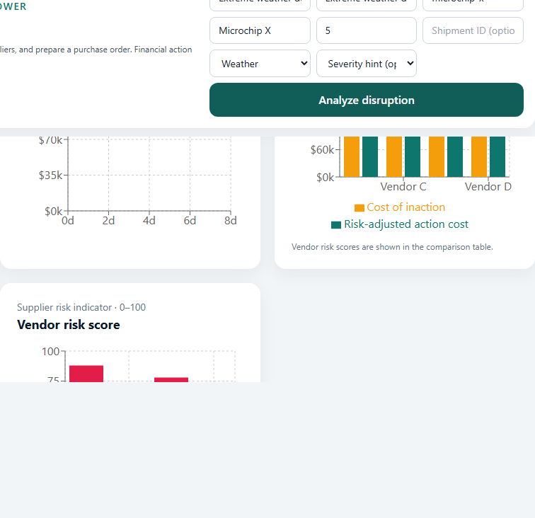
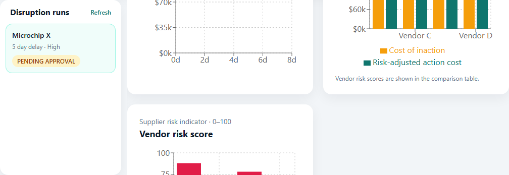
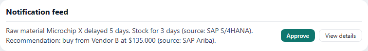
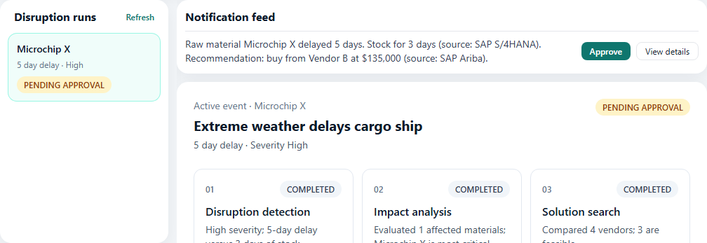
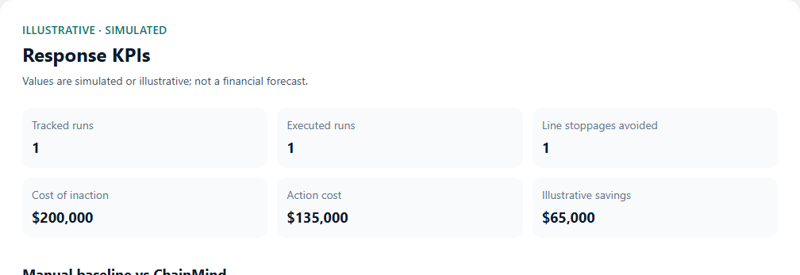


Cuplikan dashboard berbahasa Indonesia:

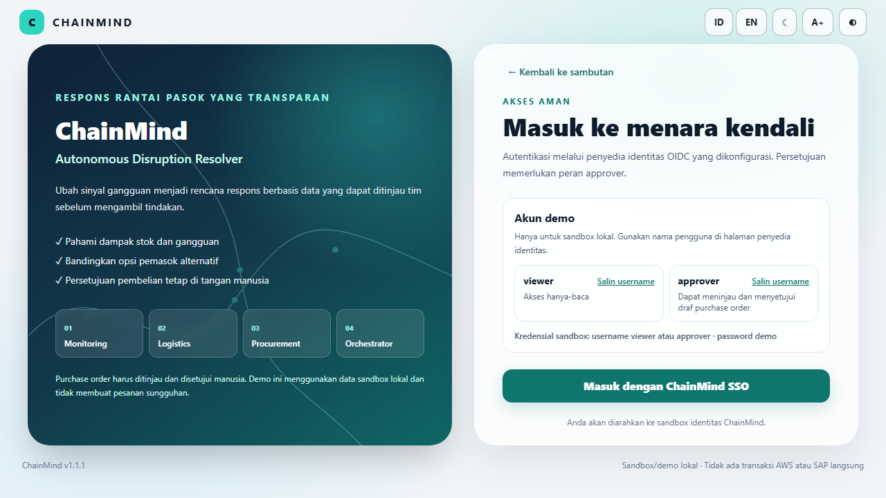

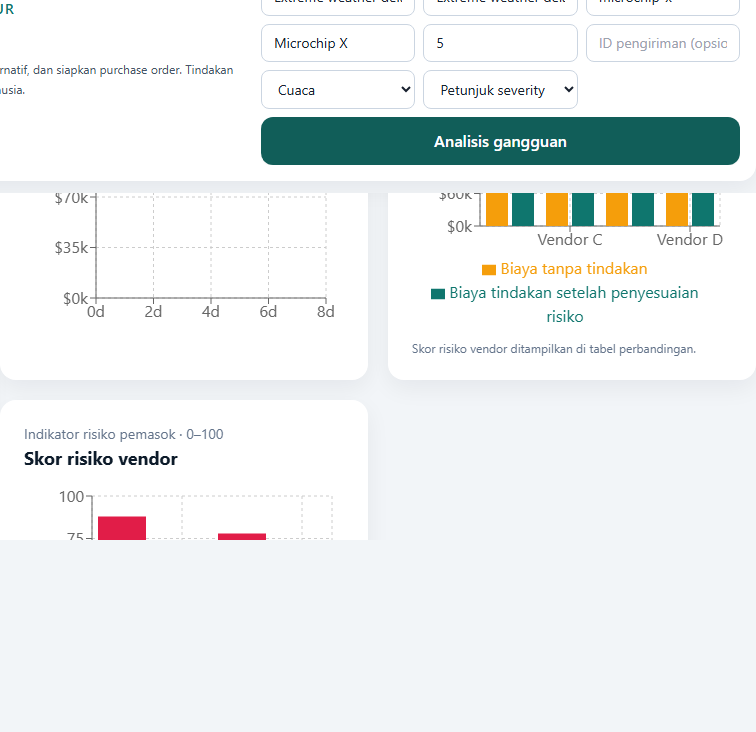
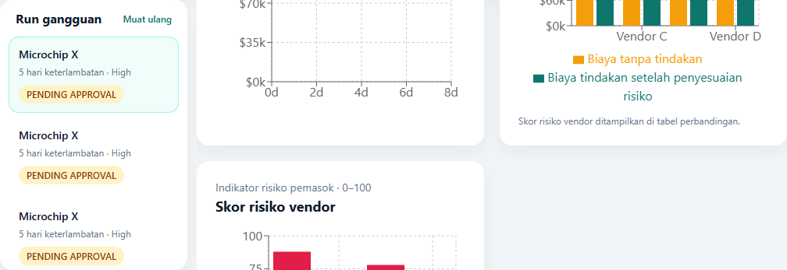
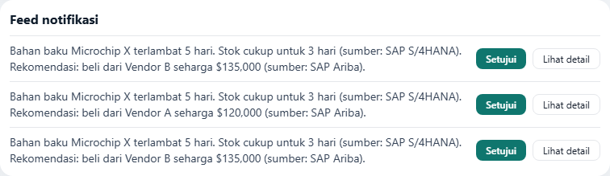
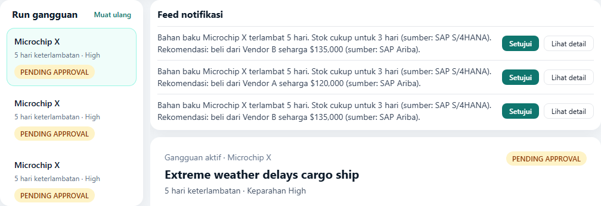
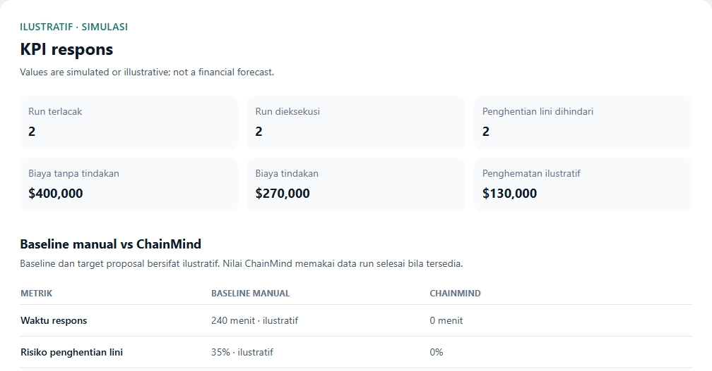


Jalankan unit test, browser-test typecheck, E2E, dan build dari folder `dashboard`:

```powershell
npm test
npm run typecheck:e2e
npm run test:e2e
npm run build
```

### Semua layanan lokal dengan Docker Compose

Dengan Docker Engine dan Docker Compose tersedia, jalankan dari root:

```powershell
docker compose up --build
```

atau gunakan `make run-all`. API, SAP sandbox, dan dashboard tersedia masing-masing di
`http://localhost:8000`, `http://localhost:8100`, dan `http://localhost:5173`.
Konfigurasi Compose memakai shared/signing secret demo lokal saja; jangan gunakan nilainya
di deployment. Hentikan layanan dengan `docker compose down` atau `make down`.

### Semua layanan lokal di Windows tanpa Make atau Docker

Setelah dependency terpasang (`uv sync --extra dev` dan `cd dashboard; npm ci`), dari root jalankan:

```powershell
.\scripts\run_all.ps1
```

Launcher menyalakan fake OIDC/SAP sandbox, API, dan Vite; menunggu health checks; lalu menampilkan
URL serta akun demo. Tekan `Ctrl+C` pada terminal yang sama untuk menghentikan proses. Alternatifnya:
`uv run python scripts/run_all.py`.

### Tes, lint, dan sintesis infrastruktur

Dari root proyek:

```powershell
uv run pytest -q
uv run ruff check src tests scripts infra sandbox
uv run ruff format --check src tests scripts infra sandbox
uv pip install --python .venv\Scripts\python.exe -r infra\requirements.txt
cd infra
npx --yes aws-cdk synth
```

CDK dapat disintesis tanpa Docker atau kredensial AWS. Untuk menyiapkan virtual environment dengan `pip` bila `uv` belum tersedia, lihat petunjuk di [docs/DEMO.md](./docs/DEMO.md).

## Mock mode dan AWS mode

Mode default `CHAINMIND_MODE=mock` berjalan lokal dan deterministik, tanpa AWS credentials atau koneksi SAP. Preset `CHAINMIND_MODE=aws` memilih backend LLM Bedrock dan SAP Integration Suite; pilihan dapat ditimpa secara terpisah memakai `CHAINMIND_SAP_BACKEND` dan `CHAINMIND_LLM_BACKEND`. Sandbox lokal memakai HTTP dan seed fixture. Koneksi Integration Suite produksi masih memerlukan tenant dan kontrak API SAP yang tervalidasi.

CDK mendefinisikan empat Bedrock Agents dan alias, lima action schema Lambda, serta guardrail untuk PII dan topik di luar supply chain. `bedrock_agents` memakai runtime agent untuk penjelasan dan trace; pemilihan vendor, coverage, dan perhitungan biaya tetap dilakukan oleh Python. Agent AWS memerlukan model/alias yang tersedia di akun dan region tujuan. Definisi ini baru diuji dengan template CDK, belum dideploy atau divalidasi di akun AWS.

Salin `.env.example` ke `.env` bila ingin mengubah konfigurasi lokal. `.env` tidak boleh ditambahkan ke repository.

| Variabel | Default | Kegunaan |
| --- | --- | --- |
| `CHAINMIND_MODE` | `mock` | Pilihan adapter: `mock` atau `aws` |
| `CHAINMIND_AUTH_ISSUER` | `http://127.0.0.1:8100` | OIDC issuer yang dipercaya API |
| `CHAINMIND_AUTH_AUDIENCE` | `chainmind-dashboard` | Audience ID token yang harus cocok |
| `CHAINMIND_AUTH_JWKS_URL` | `http://127.0.0.1:8100/.well-known/jwks.json` | Endpoint key set untuk verifikasi signature |
| `CHAINMIND_AUTH_DEV_BYPASS` | `false` | Bypass lokal khusus mock; jangan aktifkan di lingkungan bersama/produksi |
| `CHAINMIND_SAP_BACKEND` | preset dari `CHAINMIND_MODE` | Pilihan SAP: `mock`, `sandbox`, `real` |
| `CHAINMIND_LLM_BACKEND` | preset dari `CHAINMIND_MODE` | Pilihan model: `mock`, `bedrock`, `bedrock_agents` |
| `CHAINMIND_AWS_REGION` | `us-east-1` | AWS region untuk boto3 dan Bedrock |
| `CHAINMIND_BEDROCK_MODEL_ID` | `anthropic.claude-3-haiku-20240307-v1:0` | ID model Converse Bedrock |
| `CHAINMIND_BEDROCK_AGENT_ID` | — | ID agent untuk backend `bedrock_agents` |
| `CHAINMIND_BEDROCK_AGENT_ALIAS_ID` | — | Alias agent yang dipakai saat runtime |
| `CHAINMIND_STOCKOUT_TOLERANCE_DAYS` | `0` | Toleransi waktu kedatangan di luar cakupan stok |
| `CHAINMIND_SAFETY_RESERVE_DAYS` | `0.25` | Cadangan hari untuk estimasi stockout residual |
| `CHAINMIND_RETRY_ATTEMPTS` | `3` | Percobaan maksimal integrasi |
| `CHAINMIND_RETRY_BASE_DELAY_SECONDS` | `0.1` | Jeda awal exponential backoff |
| `CHAINMIND_MAX_REVISIONS` | `3` | Batas revisi vendor sebelum approval ditolak |
| `CHAINMIND_EVENT_TABLE_NAME` | `chainmind-events` | Tabel event/run DynamoDB |
| `CHAINMIND_EVENT_DATABASE_PATH` | `data/chainmind-events.sqlite3` | File SQLite run/event lokal dan index idempotensi |
| `CHAINMIND_EVENT_BUS_NAME` | `chainmind` | Event bus tujuan event bridge dan external poller |
| `CHAINMIND_EVENT_BRIDGE_SECRET` | — | HMAC secret untuk verifikasi signed event bridge lokal |
| `CHAINMIND_NOTIFICATION_BACKENDS` | `["console"]` | Channel: `console`, `teams`, `slack`, `email` |
| `CHAINMIND_NOTIFICATION_LINK_SECRET` | — | Kunci HMAC lokal minimal 32 karakter; gunakan Secrets Manager di AWS |
| `CHAINMIND_NOTIFICATION_LINK_SECRET_ID` | — | Secret ID untuk kunci link di AWS mode |
| `CHAINMIND_NOTIFICATION_LINK_TTL_MINUTES` | `60` | Masa berlaku approve/view link |
| `CHAINMIND_NOTIFICATION_APPROVAL_OVERDUE_MINUTES` | `1440` | Ambang eskalasi approval tertunda |
| `CHAINMIND_NOTIFICATION_ETA_DEVIATION_THRESHOLD_DAYS` | `0` | Ambang alert deviasi ETA |
| `CHAINMIND_NOTIFICATION_TEAMS_WEBHOOK_URL` | — | Incoming webhook Teams; jangan commit URL nyata |
| `CHAINMIND_NOTIFICATION_SLACK_WEBHOOK_URL` | — | Incoming webhook Slack; jangan commit URL nyata |
| `CHAINMIND_NOTIFICATION_EMAIL_SENDER` / `_RECIPIENT` | — | Alamat SES AWS atau metadata email mock |
| `CHAINMIND_NOTIFICATION_EMAIL_OUTBOX_PATH` | `data/notifications.jsonl` | File outbox saat channel email berjalan di mock |
| `CHAINMIND_ARTIFACT_BUCKET_NAME` | `chainmind-artifacts` | Nama bucket artefak yang dapat dikonfigurasi |
| `CHAINMIND_API_CORS_ORIGINS` | `["http://localhost:5173","http://127.0.0.1:5173"]` | Daftar origin JSON yang diizinkan |
| `CHAINMIND_SAP_BASE_URL` | — | Titik konfigurasi untuk integrasi SAP mendatang |
| `CHAINMIND_SAP_INTEGRATION_SUITE_URL` | — | Base URL SAP Integration Suite untuk backend `real` |
| `CHAINMIND_SAP_TOKEN_URL` | — | OAuth2 client-credentials token endpoint |
| `CHAINMIND_SAP_CLIENT_ID` | — | Client ID SAP pada development lokal |
| `CHAINMIND_SAP_CLIENT_SECRET` | — | Client secret SAP pada development lokal; jangan commit |
| `CHAINMIND_SAP_SECRETS_SECRET_ID` | — | Secrets Manager secret ID untuk AWS mode |
| `CHAINMIND_SAP_TIMEOUT_SECONDS` | `10` | Timeout HTTP SAP |
| `CHAINMIND_SAP_WORKFLOW_BASE_URL` | `http://127.0.0.1:8100` | Base URL Business Workflow sandbox |
| `SAP_SANDBOX_EVENT_WEBHOOK_URL` | `http://127.0.0.1:8000/event-bridge` | Tujuan webhook Event Mesh simulator lokal |
| `SAP_SANDBOX_EVENT_BRIDGE_SECRET` | — | HMAC secret yang harus sama dengan `CHAINMIND_EVENT_BRIDGE_SECRET` |
| `SAP_SANDBOX_WORKFLOW_CALLBACK_URL` | `http://127.0.0.1:8000` | Base URL callback workflow simulator lokal |
| `SAP_SANDBOX_OIDC_ISSUER` | `http://127.0.0.1:8100` | Issuer fake OIDC sandbox |
| `SAP_SANDBOX_OIDC_AUDIENCE` | `chainmind-dashboard` | Audience token demo |
| `SAP_SANDBOX_OIDC_CLIENT_ID` | `chainmind-dashboard` | Client ID public untuk authorization code flow |
| `SAP_SANDBOX_OIDC_REDIRECT_URI` | `http://localhost:5173/` | Callback SPA yang diizinkan IdP |

AWS credentials tidak dimasukkan ke berkas konfigurasi proyek: boto3 menggunakan AWS credential chain standar.
Gunakan kredensial dummy hanya untuk SAP sandbox lokal. Backend `real` belum diverifikasi terhadap tenant SAP asli.

### SAP sandbox lokal

Jalankan di terminal lain:

```powershell
uv run uvicorn sap_sandbox.main:app --app-dir sandbox --host 127.0.0.1 --port 8100 --reload
```

OpenAPI UI tersedia di `http://localhost:8100/docs`. Simulator mencakup OData stock dan purchase order, Ariba sourcing/offer, OAuth token demo, Event Mesh webhook, workflow approval callback, dan empat skenario gangguan. `make run-sap-sandbox` menjalankan perintah server yang sama pada lingkungan yang menyediakan `make`.

## Struktur proyek

```text
chainmind/
├── .github/                 # CI, Dependabot, issue dan PR templates
├── dashboard/               # React + TypeScript + Vite + Tailwind
├── docs/                    # Arsitektur, API, dan skenario presentasi
├── infra/                    # AWS CDK untuk Python
├── scripts/                  # Demo CLI, launcher, verifier tenant SAP opt-in
├── contracts/sap/            # JSON Schema untuk mapping OData/adapter SAP
├── sandbox/sap_sandbox/      # Simulator lokal OData, Ariba, Event Mesh, workflow
├── src/chainmind/
│   ├── agents/               # Monitoring, logistics, procurement, orchestrator, tracking
│   ├── api/                  # FastAPI routes
│   ├── core/                 # Model, config, audit, event store, retry
│   ├── data/                 # Seed scenario, inventory, vendor
│   ├── handlers/             # Wrapper AWS Lambda
│   ├── integrations/         # LLM, SAP, AWS, and external event adapters
│   └── workflow/             # Pipeline framework-agnostic dan transisi workflow
├── tests/                    # Unit, API, retry, dan end-to-end
├── .env.example
├── pyproject.toml
└── README.md
```

## Roadmap dan batas MVP

- [x] Tambahkan konfirmasi Ariba, ASN/ETA, proyeksi stok ilustratif, dan endpoint KPI; kontrak HTTP hanya diverifikasi terhadap sandbox.
- [ ] Validasi custom API tracking dan seluruh mapping OData pada tenant SAP Integration Suite/Ariba yang nyata.
- [x] Paketkan dependency Python sebagai asset Lambda Linux/Python 3.12 dan uji isi asset; tetap perlu verifikasi deployment nyata.
- [x] Hubungkan endpoint approval ke callback token Step Functions (`SendTaskSuccess`/`SendTaskFailure`) dan tambahkan idempotensi.
- [x] Tambahkan Cognito authorizer/group scaffold, KMS, private VPC endpoints, CloudTrail, audit archive, retention, alarms, dan CloudWatch dashboard (synth-only).
- [x] Tambahkan fake OIDC/OAuth PKCE untuk viewer/approver dan uji alur dashboard lokal; federation Cognito/IAS nyata belum diuji.
- [x] Jalankan cdk-nag AwsSolutions dengan alasan suppression tertulis dan tambahkan assertion CDK.
- [x] Tambahkan launcher lokal Windows, naskah demo/pitch, dan screenshot dashboard.
- [x] Verifikasi contract mapping OData sandbox, respons Ariba OData envelope, dan sediakan live smoke test tenant yang opt-in.
- [ ] Uji deduplikasi serentak, rotasi HMAC, dan alur event end-to-end dalam akun AWS.
- [ ] Jalankan `scripts/verify_sap_tenant.py` dengan tenant SAP/BTP uji yang disetujui.

**Disclaimer MVP:** integrasi SAP saat ini adalah mock/stub; seed data, event store mock, dan keputusan human-in-the-loop lokal dimaksudkan untuk demo. AWS CDK adalah scaffold yang dapat disintesis, bukan deployment atau sertifikasi kesiapan produksi.

Notifikasi Teams/Slack diuji terhadap server HTTP lokal untuk memeriksa Adaptive Card, Block Kit,
retry, dan kegagalan; SES diverifikasi dengan botocore Stubber tanpa mengirim email. Link tindakan
bertanda tangan dan kedaluwarsa tidak mengeksekusi PO melalui GET: link approval memerlukan role
`approver` serta konfirmasi eksplisit. Eskalasi approval overdue diuji end-to-end dan hanya menambah
audit/notifikasi; status PO tetap menunggu persetujuan. CDK menjalankan pemeriksaan terjadwal dan
menyediakan timeout Step Functions sebagai eskalasi cadangan.

## Proposal coverage matrix

Berdasarkan proposal lokal di `docs/reference/ChainMind_Proposal.pdf`, matriks berikut menyeimbangkan apa yang sudah benar-benar dibuat di repository dengan status mock/sandbox/synth-only yang sesuai. Tidak ada klaim verifikasi AWS atau SAP tenant nyata.

| Section proposal | Status | Bukti utama | Verifikasi |
| --- | --- | --- | --- |
| 3 — konsep dan skenario | Implemented | [demo pipeline](./tests/test_demo_pipeline.py), [seed data](./src/chainmind/data/) | unit-tested |
| 5 — agent dan action groups | Implemented (mock) | [agents](./src/chainmind/agents/), [CDK stack](./infra/chainmind_stack.py) | unit-tested, synth-only |
| 6 — workflow dan approval | Implemented (mock) | [workflow](./src/chainmind/workflow/), [approval API](./src/chainmind/api/main.py) | unit-tested, synth-only |
| 7 — SAP/Ariba | Partial | [SAP sandbox](./sandbox/sap_sandbox/), [SAP clients](./src/chainmind/integrations/sap/) | sandbox-verified; needs real SAP |
| 7 — live figure flow and tracking | Implemented (mock) | [Flow diagram](./dashboard/src/FlowDiagram.tsx), [proposal step audit](./src/chainmind/core/models.py), [tracking outputs](./src/chainmind/agents/tracking.py) | component-tested, Playwright/axe, pipeline-tested; AWS/SAP live needs real accounts |
| 8 — notifikasi dan human approval | Implemented | [notification adapters](./src/chainmind/notifications/), [dashboard approval flow](./dashboard/src/) | unit-tested, Playwright, mock channels |
| 9 — keamanan/operations | Partial | [JWT validation](./src/chainmind/api/), [CDK stack](./infra/chainmind_stack.py), [DEPLOY.md](./docs/DEPLOY.md) | synth-only; no live AWS/security certification |
| 10 — dashboard/demo | Implemented | [dashboard](./dashboard/src/), [demo guide](./docs/DEMO.md), [screenshots](./docs/screenshots/) | unit-tested, build, Playwright |
| 11 — model bisnis | Partial | [business draft](./docs/BUSINESS.md), [marketplace packaging notes](./docs/MARKETPLACE.md) | usage-metering unit-tested; pricing/marketplace assumptions TBD |
| 12 — KPI framework | Implemented (illustrative baselines) | [KPI API](./src/chainmind/api/main.py), [KPI models](./src/chainmind/core/models.py), [dashboard KPI page](./dashboard/src/) | unit-tested; run response time measured locally, comparison targets illustrative |
| Tenant metering | Implemented (local scaffold) | [tenant auth](./src/chainmind/api/identity.py), [usage API](./src/chainmind/api/main.py), [usage page](./dashboard/src/components.tsx) | unit-tested; pricing defaults illustrative, no billing integration |
| 21 — vendor locality and BOM impact | Implemented (seeded simulation) | [procurement](./src/chainmind/agents/procurement.py), [inventory fixtures](./src/chainmind/data/seed_inventory.json), [BOM impact UI](./dashboard/src/components.tsx) | unit-tested; supplier regions/distances and BOM are simulated |
| 21 — bilingual/accessibility UI | Implemented | [translations](./dashboard/src/i18n.ts), [dashboard](./dashboard/src/App.tsx), [Playwright checks](./dashboard/e2e/auth-workflow.spec.ts) | dashboard unit/build, Playwright axe scan and 375px/1280px checks |
| 21 — model-agnostic Bedrock configuration | Implemented (adapter configuration) | [settings](./src/chainmind/core/config.py), [Bedrock adapter](./src/chainmind/integrations/llm/bedrock.py), [fallback adapter](./src/chainmind/integrations/llm/bedrock_agents.py) | unit-tested configuration; model access and runtime behavior need real AWS |
| 22 — release and cost readiness | Implemented (scaffold) | [CHANGELOG](./CHANGELOG.md), [CDK budget/tags](./infra/chainmind_stack.py), [deployment cost notes](./docs/DEPLOY.md), [jury pack](./docs/JURY_PACK.md) | CDK assertions and synth-only; live budget email and actual pricing need account review |
| 23–24 — flow, presenter and replay | Implemented (mock) | [Flow page](./dashboard/src/FlowDiagram.tsx), [replay generator](./scripts/generate_replay_fixture.py), [preflight](./scripts/preflight.py), [video script](./docs/VIDEO_SCRIPT.md) | 18 Vitest, 11 Playwright tests including axe, presenter and replay; fixture is read-only |
| 25 — proposal fidelity | Implemented (locally checkable claims) | [fidelity tests](./tests/test_proposal_fidelity.py), [tracking outputs](./src/chainmind/agents/tracking.py), [coverage](./docs/COVERAGE.md) | backend/API tests and mocked S3 archive; not real AWS/SAP |
| 26 — account readiness | Implemented (checklist/validator) | [go-live checklist](./docs/GO_LIVE.md), [offline config validation](./scripts/validate_config.py) | validator unit-tested; account verifiers require operator access |
| 27 — fixed-viewport dashboard | Implemented | [dashboard shell](./dashboard/src/App.tsx), [bilingual theme screenshots](./docs/screenshots/) | 18 Vitest, 11 Playwright; 1280×720 and 375×667 document-scroll assertions |
| 28 — tenant-supplied master data | Implemented (mock/sandbox) | [Data Studio](./dashboard/src/DataStudio.tsx), [SQLite/DynamoDB stores](./src/chainmind/core/master_data.py) | backend tests include CRUD, tenant isolation, imports, generator and custom-data pipeline; live weather polling not implemented |
| 29 — v1.1.0 release package | Implemented locally | [changelog](./CHANGELOG.md), [coverage](./docs/COVERAGE.md), [slides](./docs/slides/), [rehearsal](./docs/REHEARSAL.md) | bilingual decks rebuilt and tested; CI/merge pending release push |
| Pitch and rehearsal package | Implemented | [ID/EN slides](./docs/slides/), [reproducible builder](./scripts/build_slides.py), [Q&A](./docs/QNA.md), [rehearsal checklist](./docs/REHEARSAL.md) | test verifies 11 slides and speaker notes per deck |
| 13 — roadmap implementasi dan MVP | Partial | [demo guide](./docs/DEMO.md), [coverage audit](./docs/COVERAGE.md) | demo/sandbox verified; SAP BTP pilot remains a prerequisite |
| 15 — risk | Partial | [risk register draft](./docs/BUSINESS.md) | documentation-only |
| 16 — pendanaan / placeholders | Partial | [business draft](./docs/BUSINESS.md) | placeholders; no validated budget |

Lihat [docs/COVERAGE.md](./docs/COVERAGE.md) untuk audit yang lebih rinci serta [docs/BUSINESS.md](./docs/BUSINESS.md) untuk hipotesis bisnis, KPI, dan risiko yang masih bersifat ilustratif.

Materi presentasi: [pitch ID](./docs/slides/ChainMind_Pitch_ID.pptx),
[pitch EN](./docs/slides/ChainMind_Pitch_EN.pptx), dan [paket bukti juri](./docs/JURY_PACK.md).
Untuk membangun ulang slide, jalankan `uv run python scripts/build_slides.py`. Baca juga
[GO_LIVE](./docs/GO_LIVE.md), [DEMO](./docs/DEMO.md), [COVERAGE](./docs/COVERAGE.md),
dan [Q&A](./docs/QNA.md).

## Kontribusi

Lihat [CONTRIBUTING.md](./CONTRIBUTING.md) untuk langkah instalasi, pemeriksaan, dan cara mengajukan perubahan.

## Rilis

Versi proyek saat ini **1.1.0**. Lihat [CHANGELOG.md](./CHANGELOG.md) untuk ringkasan perubahan,
[JURY_PACK.md](./docs/JURY_PACK.md) untuk klaim dan bukti demo, serta [DEPLOY.md](./docs/DEPLOY.md)
untuk checklist biaya dan deployment yang belum pernah dijalankan.

## License

Proyek ini menggunakan MIT License dengan pemegang hak cipta `Erlangga31` pada [LICENSE](./LICENSE).
