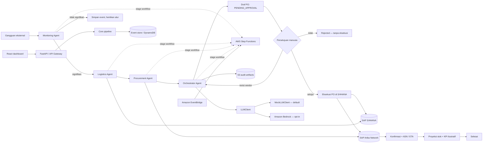

# ChainMind — Autonomous Disruption Resolver

> **English summary:** ChainMind is an offline-first, human-approved agentic AI demo for manufacturing supply-chain disruptions. It evaluates inventory risk and alternate suppliers, then prepares—but never automatically executes—a purchase order.

[](https://www.python.org/)
[](https://fastapi.tiangolo.com/)
[](https://react.dev/)
[](https://aws.amazon.com/cdk/)
[](./LICENSE)
[](https://github.com/Erlangga31/ChainMind/actions/workflows/ci.yml)

## Ikhtisar

Rantai pasok manufaktur memerlukan lebih dari sekadar alarm ketika pengiriman terlambat: tim operasi perlu memahami dampak stok, mengevaluasi alternatif vendor, dan menyiapkan tindakan yang bisa ditinjau dengan cepat. ChainMind adalah fondasi demo agentic AI untuk alur tersebut.

Sistem ERP tradisional berperan sebagai **system of record**: SAP menyimpan stok, data pemasok, dan transaksi. ChainMind menambahkan lapisan **system of action**: sejumlah agent mengubah sinyal gangguan menjadi analisis dampak, perbandingan vendor, dan draf PO yang dapat ditinjau manusia. Persetujuan manusia tetap menjadi batas wajib sebelum eksekusi.

## Skenario demo

- Kapal pengangkut Microchip X terlambat **5 hari** karena cuaca ekstrem.
- Stok SAP S/4HANA hanya mencukupi **3 hari** produksi.
- Monitoring mengklasifikasikan gangguan sebagai **High**; Logistics menghitung potensi stockout 2 hari dan perkiraan kerugian akibat berhenti produksi.
- Procurement membandingkan **empat vendor** Ariba, kapasitas, waktu kirim, biaya, serta estimasi dampak risiko.
- Orchestrator memilih **Vendor B**: pengiriman 2 hari, risiko residual terendah, dan biaya aksi tersesuaikan risiko **$135.000**.
- Mock S/4HANA mencatat draf **5.000 pcs × $27 = $135.000**, Air Freight, status **`PENDING_APPROVAL`**. Sistem menunggu approve, reject, atau revisi dari manusia.
- Setelah disetujui, demo mencatat eksekusi S/4HANA, konfirmasi pemasok dan ASN Ariba, ETA 2 hari, proyeksi stok ilustratif 6.000 pcs, serta KPI simulasi.

## Arsitektur



| Tahap | Demo lokal | Target AWS/SAP |
| --- | --- | --- |
| Ingest dan run history | FastAPI, HMAC event bridge, SQLite idempotency store | API Gateway, Secrets Manager, EventBridge, DynamoDB |
| Monitoring | JSON inventory dan shipment records, empat klasifikasi, mock event feeds | Lambda, SAP S/4HANA melalui SAP Integration Suite |
| Analisis logistik | Logistics Agent dan seed ekonomi produksi | Lambda dan data SAP |
| Perbandingan pengadaan | JSON seed vendor, Procurement Agent | Lambda dan SAP Ariba Network melalui SAP Integration Suite |
| Pemilihan dan rationale | Orchestrator Agent, MockLLMClient | Lambda, Bedrock Converse, artefak audit privat di S3 |
| Approval dan eksekusi | API/dashboard dan mock SAP | Step Functions callback, otorisasi manusia, SAP S/4HANA |
| Pelacakan pasca-eksekusi | Konfirmasi Ariba, ASN, proyeksi stok terpisah dari stok aktual | Lambda pelacakan, Ariba, custom API proyeksi S/4HANA |

Sandbox SAP lokal pada `sandbox/sap_sandbox/` menyediakan endpoint OData, vendor Ariba, webhook Event Mesh, dan workflow approval simulasi. Sandbox ini membantu pengujian kontrak HTTP lokal; bukan koneksi atau tenant SAP produksi.

Event Mesh simulator mengirim event ke `/event-bridge` dengan HMAC-SHA256. Untuk menjalankan kedua proses lokal, isi `CHAINMIND_EVENT_BRIDGE_SECRET` dan `SAP_SANDBOX_EVENT_BRIDGE_SECRET` dengan shared secret yang sama dan non-empty. `OpenMeteoWeatherClient` adalah integrasi opsional yang disabled by default; sumber gangguan lain memakai skenario mock offline.

Stack CDK mendefinisikan service AWS dan callback wait. API keputusan pada jalur AWS melanjutkan callback Step Functions; Cognito authorizer meneruskan bearer ID token yang diverifikasi backend menggunakan issuer, audience, dan JWKS Cognito.

CDK scaffold kini mencakup KMS, VPC/private subnets dan VPC endpoints, Cognito groups dan authorizer, API throttling/access logs, CloudTrail, alarms, serta dashboard CloudWatch. API memverifikasi bearer JWT terhadap issuer, audience, JWKS, dan expiry. Run snapshots dan audit/trace artifact diarsipkan ke S3 pada AWS mode. Sintesis template bukan bukti bahwa Lambda siap deploy atau bahwa integrasi AWS/SAP sudah berjalan; lihat [docs/DEPLOY.md](./docs/DEPLOY.md) sebelum mempertimbangkan deployment.

## Tech stack

| Area | Teknologi |
| --- | --- |
| Backend dan API | Python 3.12, FastAPI, Pydantic v2, pydantic-settings |
| Integrasi AWS | boto3, Amazon Bedrock Converse, DynamoDB |
| Agent AI | `LLMClient`, `MockLLMClient` offline, `BedrockLLMClient` opsional |
| Integrasi SAP | Kontrak `SAPClient`/`AribaClient`, mock S/4HANA dan Ariba, stub SAP Integration Suite |
| Workflow dan IaC | AWS Lambda, EventBridge, Step Functions, API Gateway, S3, AWS CDK for Python |
| Dashboard | React, TypeScript, Vite, Tailwind CSS, Recharts, Vitest |
| Validasi kualitas | pytest, Ruff, GitHub Actions |

## Quick start

### Backend dan API (Python 3.12)

```powershell
uv sync --extra dev
uv run python scripts/run_demo.py
uv run uvicorn chainmind.api.main:app --app-dir src --reload
```

API tersedia di `http://localhost:8000`; OpenAPI UI di `http://localhost:8000/docs`.
Endpoint utama mencakup `POST /disruptions`, `GET /runs`, `GET /runs/{run_id}`,
`POST /runs/{run_id}/decision`, dan `GET /kpis`. KPI mengagregasi run yang sudah selesai
tracking; biaya dan savings ditandai simulasi/ilustratif, bukan proyeksi finansial.
Keputusan membutuhkan bearer token OIDC dengan role `approver`; role tidak pernah dipilih melalui header. Bypass lokal hanya tersedia dengan `CHAINMIND_AUTH_DEV_BYPASS=true` saat `CHAINMIND_MODE=mock`, dan tetap mati secara default.

### Fake OIDC provider

Jalankan SAP sandbox di terminal terpisah agar login lokal tersedia:

```powershell
uv run uvicorn sap_sandbox.main:app --app-dir sandbox --host 127.0.0.1 --port 8100 --reload
```

Sandbox menyediakan discovery OIDC, JWKS RS256, authorization code + PKCE, dan dua akun demo (`viewer` atau `approver`, password `demo`). Dashboard memakai token di memori; logout atau expiry mengakhiri sesi. API di luar mock memakai bearer ID token yang diterbitkan IdP dan memeriksa audience/issuer/signature/expiry.

### Dashboard

Di terminal kedua:

```powershell
cd dashboard
npm ci
npm run dev
```

Buka `http://localhost:5173`, klik **Sign in with ChainMind SSO**, lalu masuk sebagai `viewer` atau `approver` (password `demo`). Pilih skenario, lalu klik **Trigger demo disruption**. Dashboard menampilkan linimasa enam tahap, dampak stok, tabel serta grafik vendor, trace per sumber, audit log, draf PO dengan dialog konfirmasi, tracking dan halaman KPI ilustratif. Viewer tetap read-only; hanya bearer token terverifikasi dengan role approver yang dapat mengirim keputusan.


Jalankan unit test, browser-test typecheck, E2E, dan build dari folder `dashboard`:

```powershell
npm test
npm run typecheck:e2e
npm run test:e2e
npm run build
```

### Semua layanan lokal dengan Docker Compose

Dengan Docker Engine dan Docker Compose tersedia, jalankan dari root:

```powershell
docker compose up --build
```

atau gunakan `make run-all`. API, SAP sandbox, dan dashboard tersedia masing-masing di
`http://localhost:8000`, `http://localhost:8100`, dan `http://localhost:5173`.
Konfigurasi Compose memakai shared/signing secret demo lokal saja; jangan gunakan nilainya
di deployment. Hentikan layanan dengan `docker compose down` atau `make down`.

### Tes, lint, dan sintesis infrastruktur

Dari root proyek:

```powershell
uv run pytest -q
uv run ruff check src tests scripts infra sandbox
uv run ruff format --check src tests scripts infra sandbox
uv pip install --python .venv\Scripts\python.exe -r infra\requirements.txt
cd infra
npx --yes aws-cdk synth
```

CDK dapat disintesis tanpa Docker atau kredensial AWS. Untuk menyiapkan virtual environment dengan `pip` bila `uv` belum tersedia, lihat petunjuk di [docs/DEMO.md](./docs/DEMO.md).

## Mock mode dan AWS mode

Mode default `CHAINMIND_MODE=mock` berjalan lokal dan deterministik, tanpa AWS credentials atau koneksi SAP. Preset `CHAINMIND_MODE=aws` memilih backend LLM Bedrock dan SAP Integration Suite; pilihan dapat ditimpa secara terpisah memakai `CHAINMIND_SAP_BACKEND` dan `CHAINMIND_LLM_BACKEND`. Sandbox lokal memakai HTTP dan seed fixture. Koneksi Integration Suite produksi masih memerlukan tenant dan kontrak API SAP yang tervalidasi.

CDK mendefinisikan empat Bedrock Agents dan alias, lima action schema Lambda, serta guardrail untuk PII dan topik di luar supply chain. `bedrock_agents` memakai runtime agent untuk penjelasan dan trace; pemilihan vendor, coverage, dan perhitungan biaya tetap dilakukan oleh Python. Agent AWS memerlukan model/alias yang tersedia di akun dan region tujuan. Definisi ini baru diuji dengan template CDK, belum dideploy atau divalidasi di akun AWS.

Salin `.env.example` ke `.env` bila ingin mengubah konfigurasi lokal. `.env` tidak boleh ditambahkan ke repository.

| Variabel | Default | Kegunaan |
| --- | --- | --- |
| `CHAINMIND_MODE` | `mock` | Pilihan adapter: `mock` atau `aws` |
| `CHAINMIND_AUTH_ISSUER` | `http://127.0.0.1:8100` | OIDC issuer yang dipercaya API |
| `CHAINMIND_AUTH_AUDIENCE` | `chainmind-dashboard` | Audience ID token yang harus cocok |
| `CHAINMIND_AUTH_JWKS_URL` | `http://127.0.0.1:8100/.well-known/jwks.json` | Endpoint key set untuk verifikasi signature |
| `CHAINMIND_AUTH_DEV_BYPASS` | `false` | Bypass lokal khusus mock; jangan aktifkan di lingkungan bersama/produksi |
| `CHAINMIND_SAP_BACKEND` | preset dari `CHAINMIND_MODE` | Pilihan SAP: `mock`, `sandbox`, `real` |
| `CHAINMIND_LLM_BACKEND` | preset dari `CHAINMIND_MODE` | Pilihan model: `mock`, `bedrock`, `bedrock_agents` |
| `CHAINMIND_AWS_REGION` | `us-east-1` | AWS region untuk boto3 dan Bedrock |
| `CHAINMIND_BEDROCK_MODEL_ID` | `anthropic.claude-3-haiku-20240307-v1:0` | ID model Converse Bedrock |
| `CHAINMIND_BEDROCK_AGENT_ID` | — | ID agent untuk backend `bedrock_agents` |
| `CHAINMIND_BEDROCK_AGENT_ALIAS_ID` | — | Alias agent yang dipakai saat runtime |
| `CHAINMIND_STOCKOUT_TOLERANCE_DAYS` | `0` | Toleransi waktu kedatangan di luar cakupan stok |
| `CHAINMIND_SAFETY_RESERVE_DAYS` | `0.25` | Cadangan hari untuk estimasi stockout residual |
| `CHAINMIND_RETRY_ATTEMPTS` | `3` | Percobaan maksimal integrasi |
| `CHAINMIND_RETRY_BASE_DELAY_SECONDS` | `0.1` | Jeda awal exponential backoff |
| `CHAINMIND_MAX_REVISIONS` | `3` | Batas revisi vendor sebelum approval ditolak |
| `CHAINMIND_EVENT_TABLE_NAME` | `chainmind-events` | Tabel event/run DynamoDB |
| `CHAINMIND_EVENT_DATABASE_PATH` | `data/chainmind-events.sqlite3` | File SQLite run/event lokal dan index idempotensi |
| `CHAINMIND_EVENT_BUS_NAME` | `chainmind` | Event bus tujuan event bridge dan external poller |
| `CHAINMIND_EVENT_BRIDGE_SECRET` | — | HMAC secret untuk verifikasi signed event bridge lokal |
| `CHAINMIND_NOTIFICATION_BACKENDS` | `["console"]` | Channel: `console`, `teams`, `slack`, `email` |
| `CHAINMIND_NOTIFICATION_LINK_SECRET` | — | Kunci HMAC lokal minimal 32 karakter; gunakan Secrets Manager di AWS |
| `CHAINMIND_NOTIFICATION_LINK_SECRET_ID` | — | Secret ID untuk kunci link di AWS mode |
| `CHAINMIND_NOTIFICATION_LINK_TTL_MINUTES` | `60` | Masa berlaku approve/view link |
| `CHAINMIND_NOTIFICATION_APPROVAL_OVERDUE_MINUTES` | `1440` | Ambang eskalasi approval tertunda |
| `CHAINMIND_NOTIFICATION_ETA_DEVIATION_THRESHOLD_DAYS` | `0` | Ambang alert deviasi ETA |
| `CHAINMIND_NOTIFICATION_TEAMS_WEBHOOK_URL` | — | Incoming webhook Teams; jangan commit URL nyata |
| `CHAINMIND_NOTIFICATION_SLACK_WEBHOOK_URL` | — | Incoming webhook Slack; jangan commit URL nyata |
| `CHAINMIND_NOTIFICATION_EMAIL_SENDER` / `_RECIPIENT` | — | Alamat SES AWS atau metadata email mock |
| `CHAINMIND_NOTIFICATION_EMAIL_OUTBOX_PATH` | `data/notifications.jsonl` | File outbox saat channel email berjalan di mock |
| `CHAINMIND_ARTIFACT_BUCKET_NAME` | `chainmind-artifacts` | Nama bucket artefak yang dapat dikonfigurasi |
| `CHAINMIND_API_CORS_ORIGINS` | `["http://localhost:5173","http://127.0.0.1:5173"]` | Daftar origin JSON yang diizinkan |
| `CHAINMIND_SAP_BASE_URL` | — | Titik konfigurasi untuk integrasi SAP mendatang |
| `CHAINMIND_SAP_INTEGRATION_SUITE_URL` | — | Base URL SAP Integration Suite untuk backend `real` |
| `CHAINMIND_SAP_TOKEN_URL` | — | OAuth2 client-credentials token endpoint |
| `CHAINMIND_SAP_CLIENT_ID` | — | Client ID SAP pada development lokal |
| `CHAINMIND_SAP_CLIENT_SECRET` | — | Client secret SAP pada development lokal; jangan commit |
| `CHAINMIND_SAP_SECRETS_SECRET_ID` | — | Secrets Manager secret ID untuk AWS mode |
| `CHAINMIND_SAP_TIMEOUT_SECONDS` | `10` | Timeout HTTP SAP |
| `CHAINMIND_SAP_WORKFLOW_BASE_URL` | `http://127.0.0.1:8100` | Base URL Business Workflow sandbox |
| `SAP_SANDBOX_EVENT_WEBHOOK_URL` | `http://127.0.0.1:8000/event-bridge` | Tujuan webhook Event Mesh simulator lokal |
| `SAP_SANDBOX_EVENT_BRIDGE_SECRET` | — | HMAC secret yang harus sama dengan `CHAINMIND_EVENT_BRIDGE_SECRET` |
| `SAP_SANDBOX_WORKFLOW_CALLBACK_URL` | `http://127.0.0.1:8000` | Base URL callback workflow simulator lokal |
| `SAP_SANDBOX_OIDC_ISSUER` | `http://127.0.0.1:8100` | Issuer fake OIDC sandbox |
| `SAP_SANDBOX_OIDC_AUDIENCE` | `chainmind-dashboard` | Audience token demo |
| `SAP_SANDBOX_OIDC_CLIENT_ID` | `chainmind-dashboard` | Client ID public untuk authorization code flow |
| `SAP_SANDBOX_OIDC_REDIRECT_URI` | `http://localhost:5173/` | Callback SPA yang diizinkan IdP |

AWS credentials tidak dimasukkan ke berkas konfigurasi proyek: boto3 menggunakan AWS credential chain standar.
Gunakan kredensial dummy hanya untuk SAP sandbox lokal. Backend `real` belum diverifikasi terhadap tenant SAP asli.

### SAP sandbox lokal

Jalankan di terminal lain:

```powershell
uv run uvicorn sap_sandbox.main:app --app-dir sandbox --host 127.0.0.1 --port 8100 --reload
```

OpenAPI UI tersedia di `http://localhost:8100/docs`. Simulator mencakup OData stock dan purchase order, Ariba sourcing/offer, OAuth token demo, Event Mesh webhook, workflow approval callback, dan empat skenario gangguan. `make run-sap-sandbox` menjalankan perintah server yang sama pada lingkungan yang menyediakan `make`.

## Struktur proyek

```text
chainmind/
├── .github/                 # CI, Dependabot, issue dan PR templates
├── dashboard/               # React + TypeScript + Vite + Tailwind
├── docs/                    # Arsitektur, API, dan skenario presentasi
├── infra/                    # AWS CDK untuk Python
├── scripts/                  # Demo CLI
├── sandbox/sap_sandbox/      # Simulator lokal OData, Ariba, Event Mesh, workflow
├── src/chainmind/
│   ├── agents/               # Monitoring, logistics, procurement, orchestrator, tracking
│   ├── api/                  # FastAPI routes
│   ├── core/                 # Model, config, audit, event store, retry
│   ├── data/                 # Seed scenario, inventory, vendor
│   ├── handlers/             # Wrapper AWS Lambda
│   ├── integrations/         # LLM, SAP, AWS, and external event adapters
│   └── workflow/             # Pipeline framework-agnostic dan transisi workflow
├── tests/                    # Unit, API, retry, dan end-to-end
├── .env.example
├── pyproject.toml
└── README.md
```

## Roadmap dan batas MVP

- [x] Tambahkan konfirmasi Ariba, ASN/ETA, proyeksi stok ilustratif, dan endpoint KPI; kontrak HTTP hanya diverifikasi terhadap sandbox.
- [ ] Validasi custom API tracking dan seluruh mapping OData pada tenant SAP Integration Suite/Ariba yang nyata.
- [ ] Paketkan dependency Python untuk Lambda deployment dan verifikasi runtime Python 3.12.
- [x] Hubungkan endpoint approval ke callback token Step Functions (`SendTaskSuccess`/`SendTaskFailure`) dan tambahkan idempotensi.
- [x] Tambahkan Cognito authorizer/group scaffold, KMS, private VPC endpoints, CloudTrail, audit archive, retention, alarms, dan CloudWatch dashboard (synth-only).
- [ ] Hubungkan dashboard ke OAuth/PKCE dan uji akses viewer/approver Cognito end-to-end.
- [ ] Jalankan cdk-nag, selesaikan Lambda runtime dependency packaging, dan review security findings.
- [ ] Uji deduplikasi serentak, rotasi HMAC, dan alur event end-to-end dalam akun AWS.

**Disclaimer MVP:** integrasi SAP saat ini adalah mock/stub; seed data, event store mock, dan keputusan human-in-the-loop lokal dimaksudkan untuk demo. AWS CDK adalah scaffold yang dapat disintesis, bukan deployment atau sertifikasi kesiapan produksi.

Notifikasi Teams/Slack diuji menggunakan transport HTTP mock; email lokal ditulis ke outbox JSONL,
sedangkan SES hanya dipanggil pada AWS mode. Link tindakan bertanda tangan dan kedaluwarsa tidak
mengeksekusi PO melalui GET: link approval memerlukan role `approver` serta konfirmasi eksplisit.
Pengingat lokal diperiksa lewat `pipeline.check_approval_overdue`; CDK menjalankan pemeriksaan
terjadwal dan menyediakan timeout Step Functions sebagai eskalasi cadangan.

## Proposal coverage matrix

PDF proposal belum tersedia di `docs/reference/`; status berikut berasal dari requirements tertulis dan belum dibandingkan dengan dokumen sumber.

| Section prompt | Status | Bukti | Verifikasi |
| --- | --- | --- | --- |
| 3 — konsep dan skenario | Partially | [demo pipeline](./tests/test_demo_pipeline.py), [seed data](./src/chainmind/data/) | unit-tested |
| 5 — agent dan action groups | Partially | [agents](./src/chainmind/agents/), [CDK stack](./infra/chainmind_stack.py) | unit-tested, synth-only |
| 6 — workflow dan approval | Partially | [workflow](./src/chainmind/workflow/), [approval handler](./src/chainmind/handlers/approval.py) | unit-tested, synth-only |
| 7 — SAP/Ariba | Partially | [SAP sandbox](./sandbox/sap_sandbox/), [SAP clients](./src/chainmind/integrations/sap/) | sandbox-verified; needs real SAP |
| 8 — notifikasi | Partially | [notification adapters](./src/chainmind/notifications/), [tests](./tests/test_notifications.py) | unit-tested; live channels need real accounts |
| 9 — security/operations | Partially | [CDK stack](./infra/chainmind_stack.py), [deployment notes](./docs/DEPLOY.md) | synth-only; no deployment/security certification |
| 10 — dashboard/demo | Partially | [dashboard](./dashboard/src/), [demo guide](./docs/DEMO.md) | unit-tested, build; mock roles only |
| 11 — business model | Partially | [business draft](./docs/BUSINESS.md) | documentation-only, assumptions TBD |
| 12 — KPI framework | Partially | [KPI API](./src/chainmind/api/main.py), [KPI models](./src/chainmind/core/models.py) | unit-tested; illustrative only |
| 13 — proposal-specific item | Not implemented | [coverage limitations](./docs/COVERAGE.md) | needs proposal PDF |
| 15 — risk | Partially | [risk register draft](./docs/BUSINESS.md) | prompt-derived, not formally reviewed |

Lihat [docs/COVERAGE.md](./docs/COVERAGE.md) untuk audit prompt-derived yang lebih rinci dan [docs/BUSINESS.md](./docs/BUSINESS.md) untuk hipotesis bisnis.

## Kontribusi

Lihat [CONTRIBUTING.md](./CONTRIBUTING.md) untuk langkah instalasi, pemeriksaan, dan cara mengajukan perubahan.

## License

Proyek ini menggunakan MIT License; sebelum publikasi, ganti placeholder `<YOUR NAME>` di [LICENSE](./LICENSE) dengan nama pemegang hak cipta.
