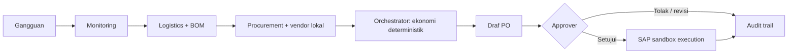

# ChainMind — paket bukti juri

## Masalah dan solusi

Gangguan logistik dapat menghabiskan buffer material sebelum tim procurement menemukan alternatif.
ChainMind menghitung coverage dan risiko penghentian lini, membandingkan pemasok, lalu menyiapkan
PO yang menunggu keputusan manusia.

## Jalur demo lima menit

1. Jalankan `.\scripts\run_all.ps1`; buka `http://127.0.0.1:5173`.
2. Masuk sebagai `approver` / `demo`, pastikan bahasa Indonesia aktif.
3. Picu skenario cuaca ekstrem: Microchip X terlambat 5 hari, buffer 3 hari.
4. Tunjukkan tabel/grafik vendor dan trace; rekomendasi default Vendor B: 2 hari, risiko 88,
   5.000 pcs × $27 = $135.000, Air Freight.
5. Tunjukkan status `PENDING_APPROVAL`, klik **Setujui**, centang konfirmasi dan kirim.
6. Tunjukkan tracking, KPI ilustratif dan feed notifikasi. Draf tidak pernah dieksekusi sebelum
   konfirmasi approver.

Lihat [DEMO.md](./DEMO.md) untuk naskah lengkap dan fallback bila sandbox lokal tidak merespons.

## Bukti verifikasi

| Klaim | Cara verifikasi | Job / suite | Batas |
| --- | --- | --- | --- |
| Perhitungan stok, vendor, approval dan isolasi tenant | pytest | Backend | Seed/mock, bukan data SAP nyata |
| SAP field/envelope dan workflow demo | contract tests + sandbox HTTP | Backend / SAP sandbox | Bukan SAP BTP tenant |
| SDK AWS, task token, event store, archive dan notifikasi | pytest melawan LocalStack | LocalStack integration | Emulator, bukan AWS account |
| Resource, IAM, encryption dan budget template | CDK assertions + `cdk synth` | Infrastructure synthesis | Tidak dideploy |
| Dashboard Indonesia/Inggris, approval, axe dan responsive | Vitest, build, Playwright | Dashboard / Dashboard end-to-end | Browser lokal/CI |

## Batas dan risiko

- SAP S/4HANA OData dan Ariba ditiru oleh sandbox; tidak ada koneksi SAP tenant, Cloud Connector,
  Integration Suite, IAS, atau supplier network nyata.
- AWS diuji dengan LocalStack dan CDK synth saja. Tidak ada deployment AWS, Bedrock invocation,
  email SES delivery, atau validasi IAM runtime.
- Data vendor, jarak, biaya, BOM, baseline KPI, tier harga, dan hasil bisnis bersifat simulasi/
  ilustratif. Budget CDK adalah notifikasi, bukan spending cap.
- Sebelum pilot: tinjau keamanan, residency, tenancy, recovery, biaya, human approval policy,
  contract/API SAP, dan uji staging berizin.

## Status rilis dan langkah operator

PR final #17 telah merged ke `main`; keenam job CI pada merge commit sukses. Rincian tahap yang
selesai, hash commit/tag, hitungan tes, antrean maintenance Dependabot, dan checklist rehearsal
yang masih harus dilakukan operator ada di [PROJECT_STATUS.md](./PROJECT_STATUS.md).

## Klaim yang boleh dipakai

> “SAP sandbox simulating S/4HANA OData and Ariba; AWS verified with LocalStack and cdk synth.”

Kalimat kedua berarti perilaku layanan SDK diuji terhadap LocalStack dan template disintesis;
kalimat tersebut **bukan** klaim AWS production/runtime verification.
