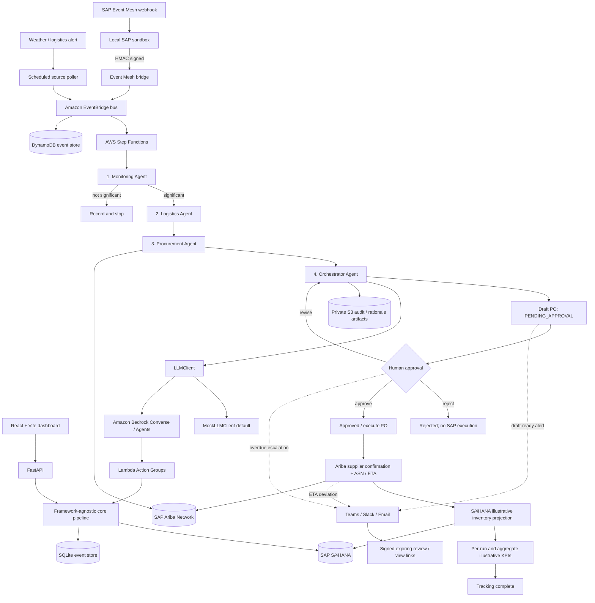

# ChainMind architecture

## Agent flow

For local development the FastAPI route calls the same sequential pipeline used by the CLI and does not contact AWS. The stack definition models the AWS event-driven path separately. Each run presents seven timeline entries in the dashboard: monitoring, logistics, procurement, orchestrator, human approval, PO execution, and supplier execution/tracking. The first four are agent stages; the approval gate precedes execution and tracking.

## Stage responsibilities and service mapping

| ChainMind stage | Core implementation | Local adapter | AWS / SAP mapping |
| --- | --- | --- | --- |
| Disruption ingress | Signed `event-bridge` route and normalized `DisruptionEvent` | HMAC-verified SAP Event Mesh simulator | API Gateway bridge Lambda, Secrets Manager, EventBridge bus/rule |
| External polling | Weather/logistics client contracts and opt-in Open-Meteo adapter | Scripted offline feeds | Scheduled EventBridge rule and poller Lambda; external polling disabled by default |
| 1. Monitoring | `MonitoringAgent` classifies four disruption types and evaluates significance | Seed inventory and shipment/open-PO records | Monitoring Lambda; reads S/4HANA inventory and shipment references |
| 2. Logistics | `LogisticsAgent` | Seed stock and consumption | Logistics Lambda; estimates stockout days and line loss |
| 3. Procurement | `ProcurementAgent` | Seed Ariba quotes | Procurement Lambda; SAP Ariba Network through SAP Integration Suite |
| 4. Orchestration | `OrchestratorAgent`, `LLMClient` | Deterministic `MockLLMClient` | Four Bedrock Agents, aliases, Lambda action groups, and shared guardrail; model output explains but cannot change Python's selection |
| Human approval | Shared transition definition, bounded revision count, approver-role check | FastAPI role header for demo only | Step Functions task token; API sends success/failure callbacks, rejection is caught as a non-execution terminal path |
| PO execution | `SAPClient.execute_purchase_order` | Mock S/4HANA in-memory record | S/4HANA via SAP Integration Suite, only after approval |
| Execution and tracking | `TrackingAgent`, typed confirmation/ASN/projection/KPI models | Ariba sandbox confirms the submitted PO and returns a vendor-specific ETA; projection is separate from current stock | Tracking Lambda after execution; Ariba confirmation/ASN; custom S/4HANA projection API |
| KPI reporting | `RunKPI`, aggregate `GET /kpis` | Values marked simulated/illustrative | DynamoDB-backed run aggregation; not a financial forecast |
| Notifications | `NotificationService` and `Notifier` contract | Console, JSONL email outbox, configurable mock webhooks | Teams/Slack webhooks, SES, scheduled pending-approval scan, Step Functions timeout escalation |
| Run/audit storage | `RunStore` contract | SQLite snapshots and unique idempotency key (configurable, defaults to `data/chainmind-events.sqlite3`) | DynamoDB run records and event-key index; private S3 rationale artifacts |

The separate local SAP sandbox (`sandbox/sap_sandbox/`) exposes OData-like S/4HANA material-stock
and purchase-order routes, seeded Ariba vendors, an HMAC-signed Event Mesh webhook simulator, and
a Business Workflow approval callback simulator. It also requires an Ariba PO submission before
returning supplier confirmation or ASN data, and stores projected stock separately from current
inventory. Configure the same non-empty
`CHAINMIND_EVENT_BRIDGE_SECRET` and `SAP_SANDBOX_EVENT_BRIDGE_SECRET` in the API and sandbox
processes to use the local signed bridge. The external mock feeds cover weather, logistics delay,
geopolitical disruption, and vendor failure. Open-Meteo is opt-in and only maps severe weather
codes to an illustrative alert. These routes and adapters are local contract-test fixtures, not
production SAP or external-source integrations.

`RealS4HANAClient` and `RealAribaClient` use the Integration Suite HTTP abstraction with OAuth
client-credentials tokens, cached tokens, CSRF-protected writes, typed response mapping, request
timeouts, and bounded retries. Contract tests execute these adapters against the local sandbox.
This validates HTTP behavior against the simulator only; SAP tenant authorization, CSRF, API
versions, proxy setup, and service-specific field mapping require verification against SAP.

The `core` package contains Pydantic domain models, agent decisions, audit entries, and the sequential workflow. FastAPI, Lambda, boto3-backed storage, Bedrock, and SAP are adapters around that logic. The orchestration calculation is deterministic; the LLM client explains the result and does not choose or override the winning vendor.

Bedrock Agent instructions live in `src/chainmind/prompts/`; action contracts live in
`infra/schemas/`. Action-group handlers validate the Bedrock event and Pydantic domain input
before calling existing agents and SAP interfaces. The mock and Bedrock adapters return the
same source-attributed trace model. Invalid or low-confidence agent output uses a deterministic
explanation fallback and adds an audit entry; it never changes the already-selected vendor or
financial calculations. Bedrock resources and their Lambda permissions have been template-tested
only; deployment and runtime behavior require an AWS account with model access.

## Decision economics

- Coverage is `current_stock / daily_consumption`.
- Inaction cost is `max(delay_days - coverage_days, 0) * line_stoppage_cost_per_day`.
- A vendor is feasible when capacity covers the order and its lead time is within stock coverage plus tolerance, or it improves the original stockout duration.
- Action cost includes the quoted total, expedite cost, and freight cost.
- Risk-adjusted residual loss estimates reserve-adjusted stockout days multiplied by daily line-stoppage cost and supplier `risk_score / 100` (a larger score means more delay risk).
- The orchestrator chooses the feasible vendor with the lowest action cost plus residual loss; equal totals prefer the lower risk score.

For the seed scenario, stock covers three days, delay is five days, and the configured inaction estimate is $200,000. Vendor B arrives in two days. It costs $135,000 and has no reserve-adjusted stockout exposure, while the cheaper but slower/less reliable alternatives have greater residual loss. Its 5,000-piece draft is $27 per piece and remains pending approval.

After approval, the tracking stage records the Ariba confirmation and vendor-specific ASN ETA,
then calculates projected stock at arrival without overwriting the SAP current-stock snapshot.
Per-run `cost_of_inaction`, action cost, and savings are labeled simulated/illustrative and do not
represent a financial forecast. `GET /kpis` aggregates only runs with completed tracking.

Notifications are generated for a ready draft, overdue pending approval, and ETA deviation. Approve
links are signed, scoped, and expiring; opening one only presents a review. The decision endpoint
still requires an approver role and an explicit confirmation request. Local mode uses an ephemeral
process key unless `CHAINMIND_NOTIFICATION_LINK_SECRET` is configured, so mock links do not survive
restarts by default. AWS mode reads the signing key from Secrets Manager.

## Trust boundary and failure behavior

- Mock mode is the default and uses local JSON seed data. It makes no AWS or SAP calls.
- `aws` mode selects Bedrock and DynamoDB; the SAP classes intentionally fail with structured errors until a real SAP Integration Suite adapter is configured.
- Integration calls retry only typed transient integration failures with bounded exponential backoff.
- Every agent step and human decision appends a UTC audit entry with an input summary, output summary, and human-readable reasoning.
- The orchestrator creates a draft; it never approves or executes one. The `approve` path alone invokes the SAP execution adapter. Rejection does not execute; revision creates a replacement draft that is still pending and is capped by `CHAINMIND_MAX_REVISIONS`.
- The local runner and CDK builder share the workflow-state transition definition. The Step Functions ASL has bounded revision states, task retries, an SQS dead-letter path, and X-Ray tracing. Its AWS runtime has only been checked with template synthesis and stubbed tests.
- The local API persists run snapshots and idempotency keys in SQLite. DynamoDB stores AWS run and event-key records. Event bridge authenticity is enforced by a shared-secret HMAC, but production key rotation and replay windows need additional operational policy.
- A duplicate idempotency key returns the first run instead of starting a second pipeline. SQLite uniqueness is locally enforced; production concurrent delivery and EventBridge retry behavior still require AWS integration testing.

## Resource-level IAM intent

- API Lambda: read/write access to the event table, scoped writes to the audit-artifact prefix, and invoke permission for the configured Bedrock model.
- Approval callback Lambda: write access to the callback-token event-table item.
- Orchestrator Lambda: write access to `runs/*` in the private artifact bucket.
- Step Functions: invoke permissions for only the four agent functions, approval callback, and post-approval executor.
- EventBridge rule: starts the configured state machine.
- Event bridge Lambda: reads only the dedicated HMAC secret and can publish only to the configured event bus.
- Scheduled poller Lambda: can publish only to the configured event bus; network access for optional Open-Meteo remains a deployment configuration concern.

The CDK app uses an encrypted, versioned S3 bucket with public access blocked, TLS enforced, and a DynamoDB table with on-demand capacity and point-in-time recovery. These defaults are a foundation, not a complete production security review.
