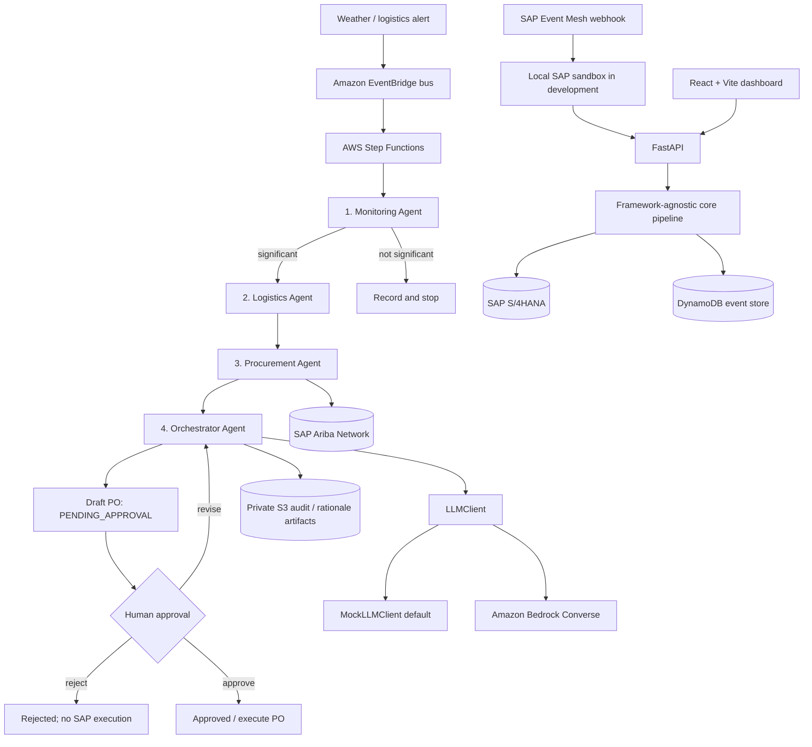

# ChainMind architecture

## Agent flow

For local development the FastAPI route calls the same sequential pipeline used by the CLI and does not contact AWS. The stack definition models the AWS event-driven path separately. Each run presents six timeline entries in the dashboard: monitoring, logistics, procurement, orchestrator, human approval, and PO execution. The first four are agent stages; the last two enforce the human gate.

## Stage responsibilities and service mapping

| ChainMind stage | Core implementation | Local adapter | AWS / SAP mapping |
| --- | --- | --- | --- |
| Disruption ingress | `DisruptionEvent`, FastAPI route | Local HTTP API | API Gateway, EventBridge bus/rule |
| 1. Monitoring | `MonitoringAgent` | JSON inventory snapshot | Monitoring Lambda; reads S/4HANA inventory |
| 2. Logistics | `LogisticsAgent` | Seed stock and consumption | Logistics Lambda; estimates stockout days and line loss |
| 3. Procurement | `ProcurementAgent` | Seed Ariba quotes | Procurement Lambda; SAP Ariba Network through SAP Integration Suite |
| 4. Orchestration | `OrchestratorAgent`, `LLMClient` | Deterministic `MockLLMClient` | Orchestrator Lambda; Bedrock Converse when `CHAINMIND_MODE=aws` |
| Human approval | `DisruptionPipeline.decide` | FastAPI / dashboard | Step Functions callback token (API completion wiring remains a deployment TODO) |
| PO execution | `SAPClient.execute_purchase_order` | Mock S/4HANA in-memory record | S/4HANA via SAP Integration Suite, only after approval |
| Run/audit storage | `EventStore` | Thread-safe process memory | DynamoDB event table and private S3 rationale artifacts |

The separate local SAP sandbox (`sandbox/sap_sandbox/`) exposes OData-like S/4HANA material-stock
and purchase-order routes, seeded Ariba vendors, an Event Mesh webhook simulator, and a Business
Workflow approval callback simulator. It uses the same inventory and vendor seed fixtures as the
application. These routes are local contract-test fixtures, not production SAP integrations.

The `core` package contains Pydantic domain models, agent decisions, audit entries, and the sequential workflow. FastAPI, Lambda, boto3-backed storage, Bedrock, and SAP are adapters around that logic. The orchestration calculation is deterministic; the LLM client explains the result and does not choose or override the winning vendor.

## Decision economics

- Coverage is `current_stock / daily_consumption`.
- Inaction cost is `max(delay_days - coverage_days, 0) * line_stoppage_cost_per_day`.
- A vendor is feasible when capacity covers the order and its lead time is within stock coverage plus tolerance, or it improves the original stockout duration.
- Action cost includes the quoted total, expedite cost, and freight cost.
- Risk-adjusted residual loss estimates reserve-adjusted stockout days multiplied by daily line-stoppage cost and supplier `risk_score / 100` (a larger score means more delay risk).
- The orchestrator chooses the feasible vendor with the lowest action cost plus residual loss; equal totals prefer the lower risk score.

For the seed scenario, stock covers three days, delay is five days, and the configured inaction estimate is $200,000. Vendor B arrives in two days. It costs $135,000 and has no reserve-adjusted stockout exposure, while the cheaper but slower/less reliable alternatives have greater residual loss. Its 5,000-piece draft is $27 per piece and remains pending approval.

## Trust boundary and failure behavior

- Mock mode is the default and uses local JSON seed data. It makes no AWS or SAP calls.
- `aws` mode selects Bedrock and DynamoDB; the SAP classes intentionally fail with structured errors until a real SAP Integration Suite adapter is configured.
- Integration calls retry only typed transient integration failures with bounded exponential backoff.
- Every agent step and human decision appends a UTC audit entry with an input summary, output summary, and human-readable reasoning.
- The orchestrator creates a draft; it never approves or executes one. The `approve` path alone invokes the SAP execution adapter. Rejection does not execute; revision creates a replacement draft that is still pending.
- The local event store is process-memory only. DynamoDB and S3 constructs are defined for AWS, but production retention, task-token API completion, authorization, and Lambda dependency packaging still need implementation.

## Resource-level IAM intent

- API Lambda: read/write access to the event table, scoped writes to the audit-artifact prefix, and invoke permission for the configured Bedrock model.
- Approval callback Lambda: write access to the callback-token event-table item.
- Orchestrator Lambda: write access to `runs/*` in the private artifact bucket.
- Step Functions: invoke permissions for only the four agent functions, approval callback, and post-approval executor.
- EventBridge rule: starts the configured state machine.

The CDK app uses an encrypted, versioned S3 bucket with public access blocked, TLS enforced, and a DynamoDB table with on-demand capacity and point-in-time recovery. These defaults are a foundation, not a complete production security review.
